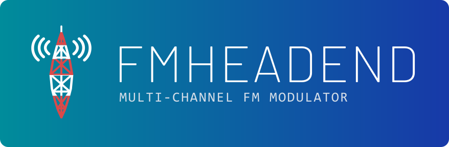
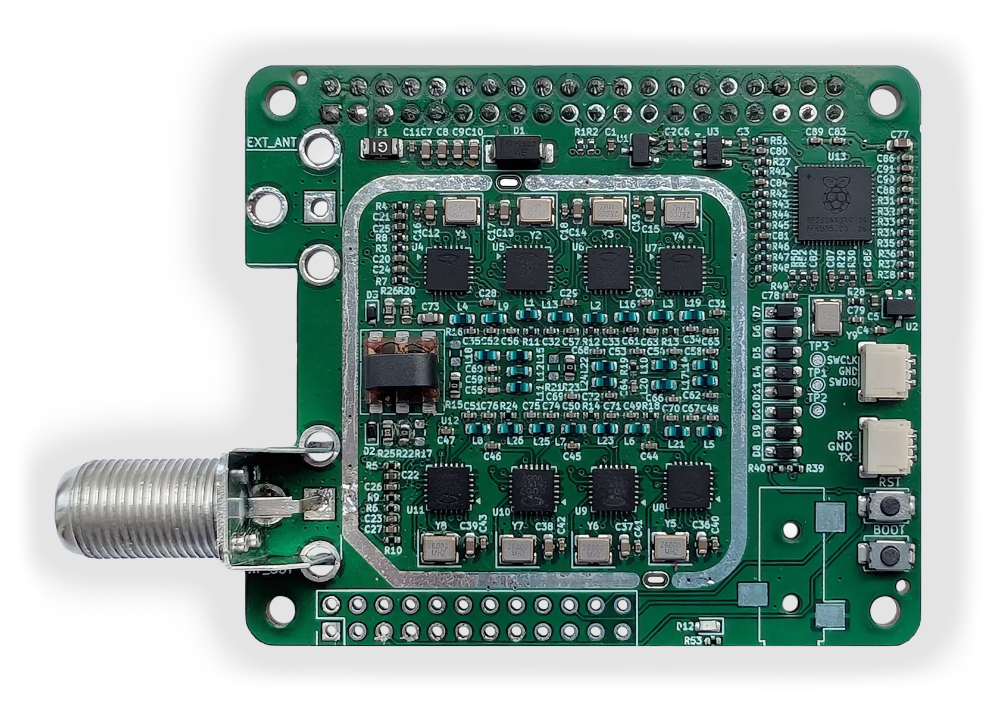
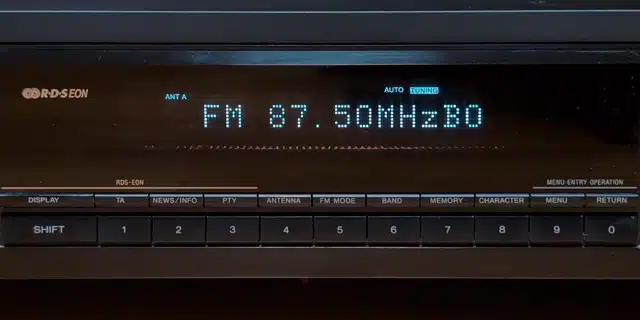
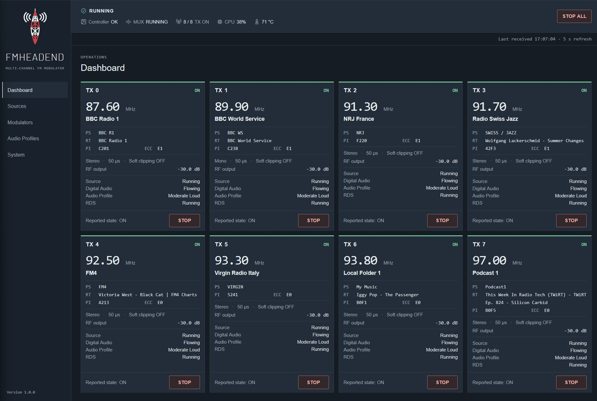
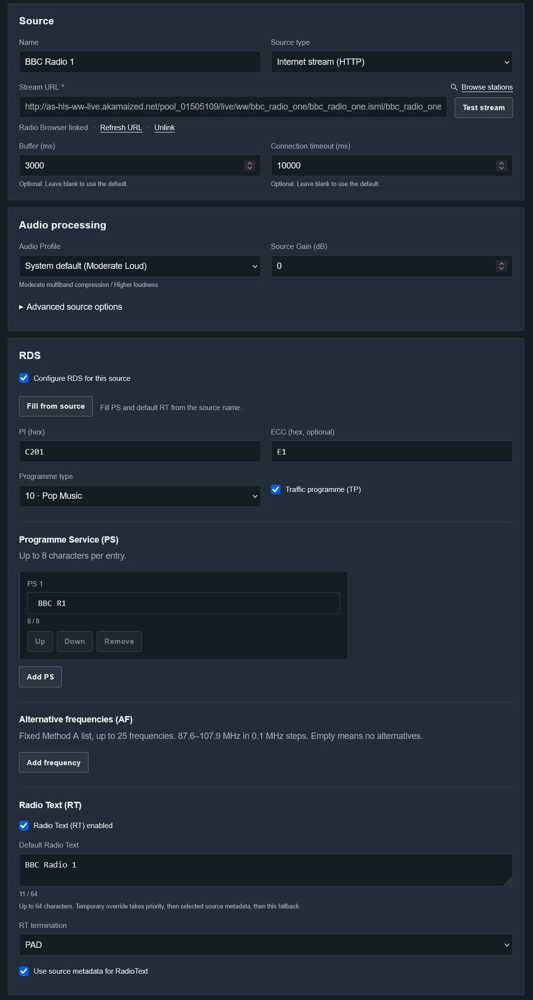
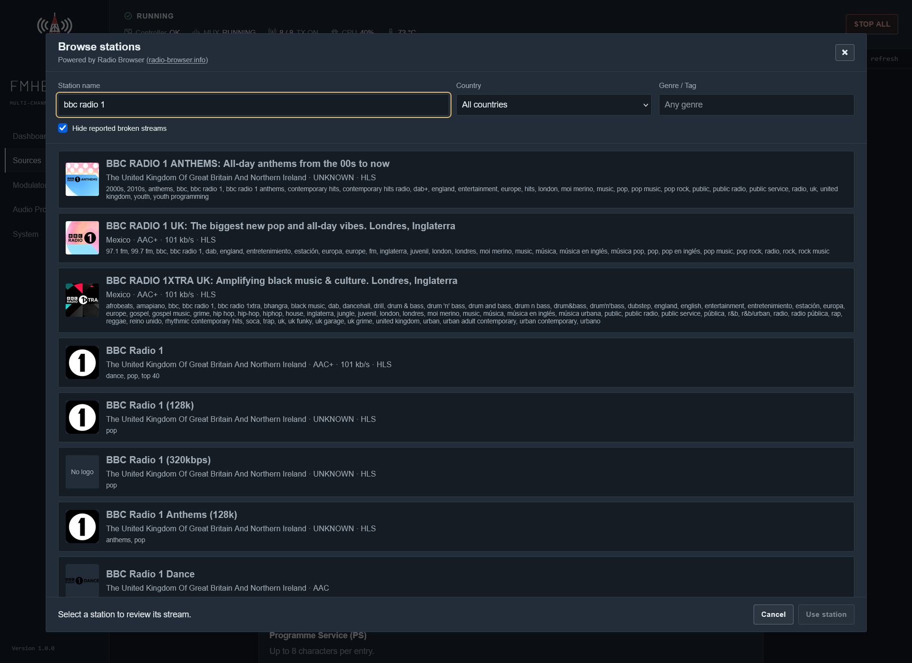
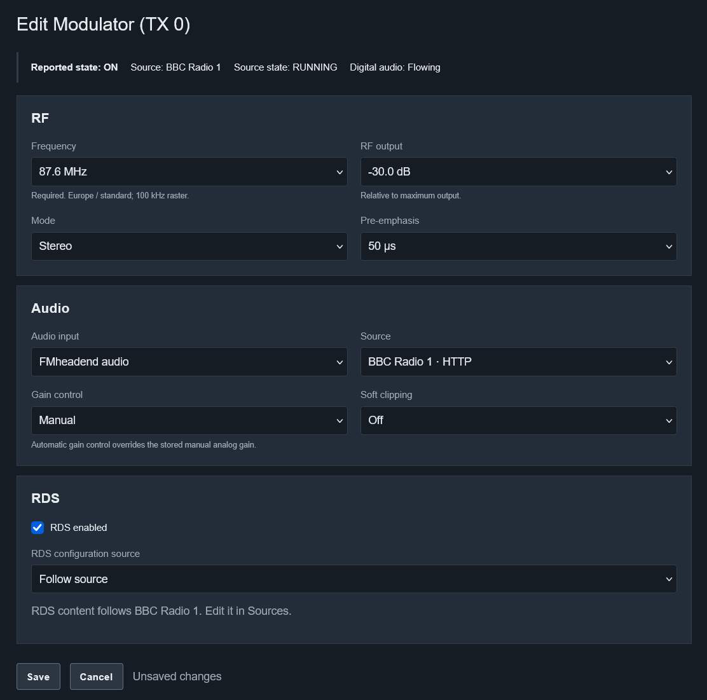
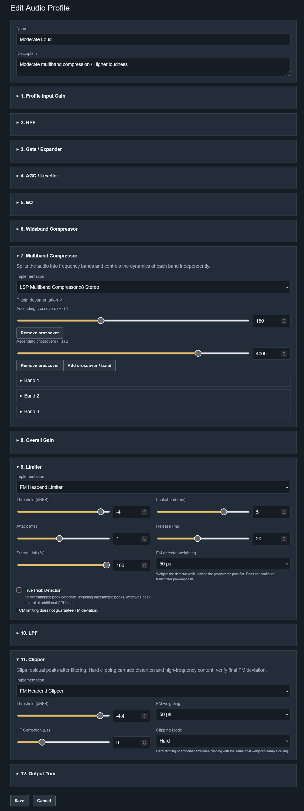

<p align="center">
  
</p>

<!--
README LAYOUT DRAFT - edit freely.
Priorities: section flow, image balance, approachable language.
TODO: replace placeholders, add a HAT-on-Pi photograph, then refine the copy.
-->

<h3 align="center">Nothing to listen to? Build your own lineup.</h3>

<p align="center">
  FMheadend is a <strong>multi-channel FM transmitter</strong> built as a Raspberry Pi HAT.
</p>

<p align="center">
  It manages internet radio streams, podcasts, music collections and other sources <strong>directly on the Pi</strong>, transmitting them on <strong>up to eight independent FM frequencies</strong> that regular radios can tune to.
</p>

<p align="center">
  
  
  
  
  
  <br>
  
  
  
  
  
</p>

<!-- TODO: replace this SVG with the real HAT-on-Pi product photograph.
Keep the square crop and 550 px display width; update the alt text. -->
<p align="center">
  
</p>

<div align="center">

https://github.com/user-attachments/assets/4a52a868-0305-410f-95b5-6a6b8546a24a

</div>

<p align="center">
  <sub>
    <a href="#the-idea-behind-fmheadend">The idea</a> &nbsp;/&nbsp;
    <a href="#features">Features</a> &nbsp;/&nbsp;
    <a href="#get-fmheadend">Get FMheadend</a> &nbsp;/&nbsp;
    <a href="#get-started">Get started</a>
  </sub>
</p>

## The idea behind FMheadend

<table align="right">
  <caption align="bottom"><sub><em>A conventional FM tuner receiving an FMheadend broadcast.</em></sub></caption>
  <tr>
    <td></td>
  </tr>
</table>

I've been a radio enthusiast for years. I'm just as interested in the technology behind it (RF, electronics and transmission) as I am in listening.

I have radios all around my home, from vintage hi-fi tuners to ordinary everyday receivers. Yet I found myself switching them on less and less. There was nothing wrong with the receivers themselves; I just wasn't particularly excited about the stations I could pick up.

I wanted the choice and variety of online audio, but with the simplicity and spontaneity of traditional radio. The initial idea was to make my favourite internet stations, unavailable on local FM frequencies, accessible on my own radios. Podcasts and music files could become radio programmes too, allowing me to choose a station instead of constantly choosing the next episode or track.

FMheadend brings all of this together in a self-contained system built around a single Raspberry Pi. Once configured, it keeps the entire lineup running independently, without a connected phone or external player.

## Features

A typical FM transmitter simply modulates a single audio input onto one frequency. FMheadend takes a different approach: it's essentially a miniature broadcast headend, managing up to eight independent FM stations, each with its own programme source, audio processing and RDS identity.

<table>
  <tr>
    <td width="33%" valign="top">
      <h3>Eight Integrated FM Modulators</h3>
      <p>FMheadend packs up to eight independently tunable stereo FM modulator ICs onto one board, with software-adjustable RF attenuation and onboard low-pass filters to suppress harmonics.</p>
    </td>
    <td width="33%" valign="top">
      <h3>Internet Radio</h3>
      <p>Play a wide variety of internet radio streams, from Icecast and SHOUTcast to HLS, using GStreamer under the hood. Discover stations through <a href="https://www.radio-browser.info/">Radio Browser</a>, a community-maintained, open-source radio station directory.</p>
    </td>
    <td width="33%" valign="top">
      <h3>Smart Podcast Playback</h3>
      <p>Turn RSS and Atom feeds into continuously playing radio programmes. FMheadend automatically checks for new episodes and selects what to play next, prioritising unplayed episodes and avoiding frequent repeats.</p>
    </td>
  </tr>
  <tr>
    <td width="33%" valign="top">
      <h3>Local Music &amp; Playlists</h3>
      <p>Play your music collection as a continuous radio station, using folders or M3U/M3U8 playlists. Music can be stored on the Raspberry Pi, a USB drive or a mounted network share.</p>
    </td>
    <td width="33%" valign="top">
      <h3>Advanced Audio Inputs</h3>
      <p>For more advanced setups, FMheadend accepts audio from ALSA capture devices, raw PCM over UDP and RTP streams carrying PCM, MP3, AAC or Opus. Multicast reception is also supported.</p>
    </td>
    <td width="33%" valign="top">
      <h3>Broadcast Audio Processing</h3>
      <p>FMheadend includes a full broadcast audio processing chain with AGC, parametric EQ, wideband and multiband compression, limiting and clipping. Ready-made presets and fully customizable DSP profiles let you shape the sound, including dedicated processors designed for FM transmission.</p>
    </td>
  </tr>
  <tr>
    <td width="33%" valign="top">
      <h3>RDS &amp; Dynamic Metadata</h3>
      <p>FMheadend includes a built-in RDS encoder, supporting PI, static and dynamic PS, PTY, TP, AF, ECC and RT. RadioText can update automatically from source metadata or be controlled externally through the REST API.</p>
    </td>
    <td width="33%" valign="top">
      <h3>Web UI &amp; REST API</h3>
      <p>Configure and control transmitters, manage audio sources and DSP profiles, and monitor system status from a browser. A documented REST API provides access to configuration, monitoring and automation for external applications.</p>
    </td>
    <td width="33%" valign="top">
      <h3>Built to Run Unattended</h3>
      <p>FMheadend is designed for continuous, unattended operation. Automatic reconnection, error recovery and persistent configuration help the system resume after interruptions without constant attention. Set it up once and let it do its job.</p>
    </td>
  </tr>
</table>

<p align="center">
  <a href="assets/dashboard.jpg?raw=true"></a>&ensp;
  <a href="assets/source-edit.png?raw=true"></a>&ensp;
  <a href="assets/radio-browser.png?raw=true"></a>&ensp;
  <a href="assets/tx-edit.png?raw=true"></a>&ensp;
  <a href="assets/dsp.png?raw=true"></a>
</p>

## Get FMheadend

FMheadend requires the dedicated FMheadend HAT and a Raspberry Pi. All software components are freely available on GitHub, including the controller firmware and audio processing plugins.

### Availability

The FMheadend HAT isn't available to order just yet, but I'm working on it! Check back soon for updates and ordering details.

### Hardware requirements

- **Raspberry Pi:** Pi 3 minimum, Pi 4 recommended.
- **Memory:** 2 GB RAM recommended.
- **Operating system:** Raspberry Pi OS Lite (64-bit).

[Detailed requirements & compatibility](docs/installation.md)

## Get started

> [!TIP]
> **Setting up FMheadend for the first time?**
>
> We strongly recommend following the **[step-by-step setup guide](docs/getting-started.md)** to get your first station on air.

**Already familiar with the setup?** Install FMheadend directly using the interactive installer:

```bash
curl -fsSL https://raw.githubusercontent.com/csalotzky/fmheadend/master/bootstrap.sh | bash
```

## Documentation & related projects

| User guides | Technical reference |
|---|---|
| [WebUI guide](docs/webui.md) | [Installation & requirements](docs/installation.md) |
| [Audio Sources](docs/sources.md) | [System architecture](docs/architecture.md) |
| [Audio processing & profiles](docs/audio.md) | [Configuration reference](docs/configuration.md) |
| [RDS](docs/rds.md) | [REST API](docs/api.md) |
| [Operations & troubleshooting](docs/operations.md) | [Controller protocol](docs/controller-protocol.md) |
| | [Controller firmware updates](docs/rp2354-firmware-update.md) |

The project has a few cooperating parts:

- **[fmheadend](https://github.com/csalotzky/fmheadend)** — this repository: Raspberry Pi software, WebUI and installation.
- **[fmheadend-controller](https://github.com/csalotzky/fmheadend-controller)** — Controller firmware for the FMheadend hardware.
- **[fmheadend-gst-plugins](https://github.com/csalotzky/fmheadend-gst-plugins)** — the FM-aware audio processing plugins.

<!-- TODO: before publishing final copy, review hardware availability, release status and measurement captions. -->
