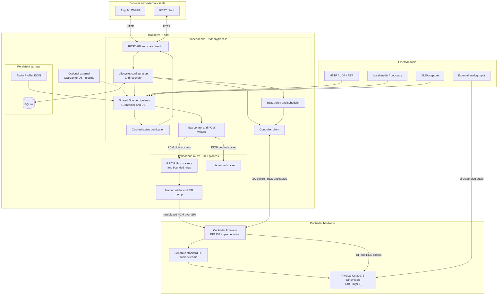
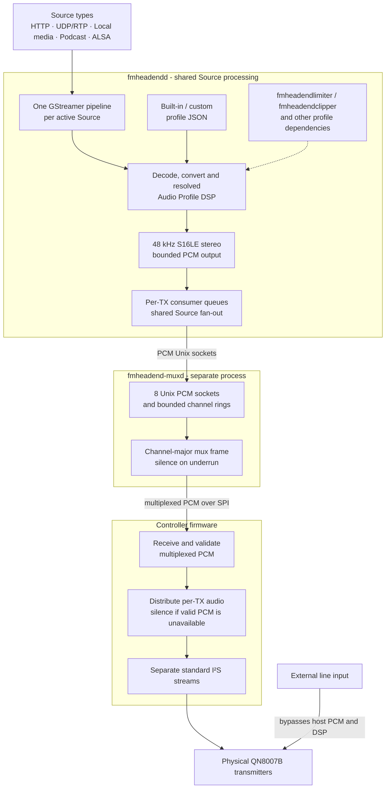
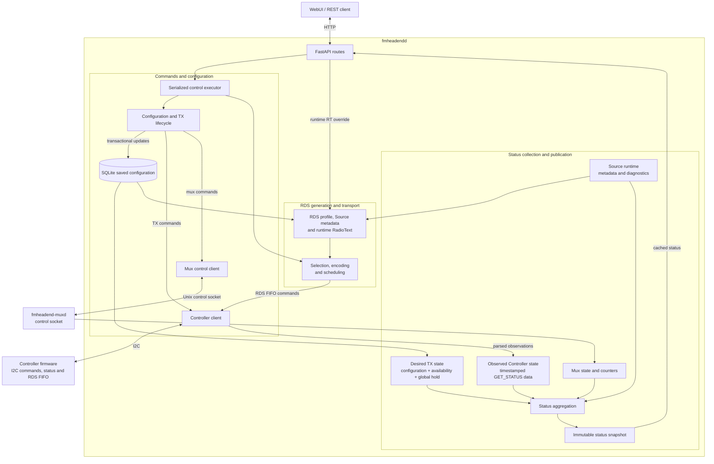
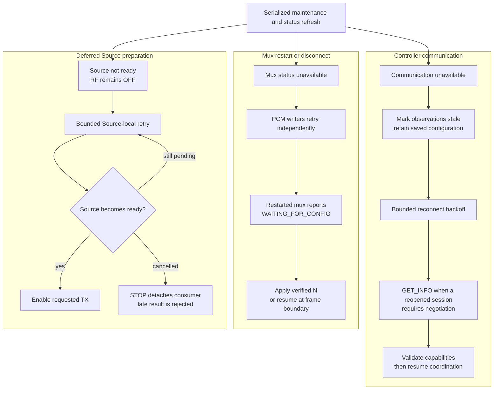

# FMheadend 1.0.0 architecture

FMheadend separates media processing, real-time PCM transport, and hardware control. The Raspberry Pi runs two cooperating services; the Controller is a separate hardware subsystem with RP2354 firmware.

## 1. System overview

Configuration reads share a repository-owned, validated in-memory generation on
the existing control executor. SQLite remains authoritative: its connection-local
`total_changes` counter invalidates the generation after writes, including bulk TX
changes and recovered stream URLs. Checking this counter executes no SQL. Reads
inside a transaction bypass the cache; rollback cannot publish uncommitted values.
Callers receive deep copies, and repository reads retain connection-thread ownership.
The first read after a change reloads the requested configuration from SQLite.

RDS ticks and status publication reuse unchanged configuration without SQL or
revalidation. Stream metadata, RT override expiration, PCM observations and hardware
status remain live. Revision checks for conditional URL recovery and durable podcast
history still use SQLite. No polling worker or TTL-based configuration refresh is
needed. Edit configuration through the API; direct database edits by another process
require stopping and restarting the daemon. The cache is discarded on restart.



| Component | Primary responsibilities |
|---|---|
| Angular WebUI | Presents configuration and cached operational status; sends REST lifecycle commands. It has no direct hardware or media access. |
| `fmheadendd` | Owns persistent configuration, Source pipelines, Audio Profile resolution, Controller coordination, RDS policy, recovery and status publication. |
| `fmheadend-muxd` | Accepts eight fixed PCM channels, maintains bounded rings, builds channel-major frames and performs synchronous SPI transfers. It does not decode media or run DSP. |
| Controller | Reports capabilities, validates and applies TX commands, receives multiplexed PCM over SPI, generates per-transmitter I²S audio, manages physical transmitters and drains RDS FIFOs. |
| SQLite | Stores Sources, eight logical Modulators, owned RDS profiles, the two system settings and durable podcast play history. Runtime queues and observations are not stored here. |
| Audio Profile files | Store built-in and custom DSP graphs. The system default is a persistent SQLite reference to one of these files. |

The FastAPI application and Source workers share the `fmheadendd` process, but control and hardware mutations pass through one serialized control executor. Media callbacks perform bounded PCM handoff only. Filesystem browsing and Source probes use separate bounded work so they do not occupy the control worker.

The systemd units remain independent. `fmheadendd.service` has `Wants=` and `After=` relationships to `fmheadend-muxd.service`, rather than a hard `Requires=` dependency. Either process can restart while the other continues reporting its own state.

## 2. Audio architecture



Every active digital Source owns one supervised GStreamer pipeline, regardless of how many Modulators consume it. Decoding, conversion, Source gain and the resolved Audio Profile therefore happen once. `PcmOutput` copies each finished PCM block to a bounded queue for every attached TX; one slow consumer cannot grow memory without bound or hold back the others.

The processing domain is 48 kHz stereo floating-point PCM when DSP stages are present. The pipeline output contract is fixed at 48 kHz, signed 16-bit little-endian, interleaved stereo. Built-in profiles select GStreamer elements; the separately maintained `fmheadendlimiter` and `fmheadendclipper` plugins are optional for daemon startup but required by profiles that reference them.

A shared backend writer reconnects each TX producer independently to muxd. Muxd retains eight sockets and rings even when fewer transmitters are fitted. Its frame builder constructs the fixed eight-channel buffer, inserting silence for an underrun, then sends only the prefix required by the verified physical count `N`. At 128 frames per packet this is one 4-byte counter followed by `N` contiguous 512-byte channel blocks, at 375 packets per second.

The Controller expects the packet width compiled for its own `TX_COUNT`. Invalid, discontinuous or stale frames are rejected. Accepted packets are completed into a static eight-lane layout; nonexistent lanes are zeroed. The RP2354 implementation uses PIO and DMA to produce a separate standard I²S stream for each physical QN8007B transmitter. In analog mode, external audio reaches that transmitter directly; no Source pipeline, PCM socket or SPI channel supplies its programme audio.

## 3. Control, RDS and status architecture



REST handlers do not manipulate GStreamer, SQLite internals, I2C or SPI directly. Configuration and lifecycle calls enter the control executor; Source workers and muxd retain ownership of their data-plane resources. Mux control uses a separate newline-delimited JSON socket. The backend never opens the SPI device.

RDS content policy lives on the host. The backend selects effective RadioText, encodes RDS groups, schedules PS/RT/AF/ECC content and refills the Controller using reported FIFO space. The Controller accepts complete groups into per-TX FIFOs and handles hardware delivery. An `RDS_PUSH` acknowledgment proves FIFO acceptance, not RF transmission.

Status is assembled from configuration, Source/PCM diagnostics, mux counters and Controller observations, then published as an immutable cache. HTTP status reads do not trigger live hardware access. Command responses and later observations are kept distinct: an accepted write, saved `enabled` value or HTTP success is not a fresh measurement of physical RF state.

## 4. Configuration, desired state and observations

Audio Profile inventory is demand-driven, separate from periodic status publication.
The list endpoint runs on the existing control executor, serialized with profile
writes. On Linux, a nonblocking inotify descriptor invalidates validated summaries
after file or directory changes; it is drained only when the list is requested.
Ancestor watches detect creation or replacement of either profile root. Watch loss
and queue overflow invalidate the inventory conservatively. There is no watcher
thread, periodic directory scan, or timer-based profile-list refresh.

API writes invalidate immediately. External edits and installed-default updates
appear on the next list request, including requests from the open WebUI. Default
selection flags are resolved from current configuration without rereading files.
Individual profile loads and active-source validation retain their existing strict
behavior; this optimization covers the inventory, not audio lifecycle validation.

Without usable inotify, listings read fresh on demand rather than polling in the
background. Cached summaries assume local Linux filesystem notification semantics;
remote filesystem changes not reported by inotify require a restart. A cold listing
can wait for the control executor and scans the complete inventory once. Invalid
documents remain excluded and logged; storage failures remain explicit API errors.

| Layer | Owner | Examples | Lifetime |
|---|---|---|---|
| Startup configuration | systemd environment / CLI | I2C device and address, HTTP listener, mux runtime directory, region | Process lifetime |
| Persistent application configuration | SQLite | Sources, eight Modulators, `enabled`, `global_stopped`, RDS ownership, default Audio Profile reference | Across restarts |
| Persistent processing content | Filesystem | Built-in and custom Audio Profile JSON | Across restarts |
| Desired operating state | Backend runtime derived from persistence | Physical and enabled TX, not held by STOP ALL, with valid configuration | Recomputed during lifecycle and recovery |
| Runtime media state | Source workers and muxd | Pipelines, PCM queues, socket connections, ring contents and counters | Process lifetime |
| Observed hardware state | Controller polling | TX ON/OFF/ERROR, attenuation, RDS FIFO space and Controller errors | Timestamped; can become stale |

SQLite always contains logical Modulator IDs 0 through 7. `GET_INFO` is the authority for the connected Controller's physical count `N`, so public operations expose only IDs 0 through `N-1`. A verified capacity reduction disables absent logical Modulators without deleting their remaining configuration. A temporary communication failure does not invent a count or rewrite saved configuration.

The effective desired state includes the persistent global STOP ALL hold. Source readiness is a precondition for enabling a digital TX, but it is runtime state, not configuration. The backend compares desired and observed state in status snapshots; retained capability or TX data is marked stale when current Controller communication is unavailable.

## 5. Startup and recovery

### 5.1 Startup

```mermaid
sequenceDiagram
    participant M as fmheadend-muxd
    participant B as fmheadendd
    participant S as Source pipeline
    participant C as Controller

    M->>M: Create PCM and control sockets
    M->>M: WAITING_FOR_CONFIG; no SPI transfer
    B->>B: Open SQLite and Audio Profiles
    B->>C: GET_INFO
    C-->>B: Identity, capabilities and physical count N
    B->>B: Apply physical inventory to saved selections
    B->>C: OFF, configure and clear RDS for physical TXs
    opt Saved desired digital transmission
        B->>S: Start or join the selected Source
        alt Decoded PCM is ready
            S-->>B: Source ready
            B->>C: SET_TX_ENABLED ON
        else Source preparation is pending
            S-->>B: Pending or unavailable
            B->>B: Keep RF OFF and defer start
        end
    end
    B->>C: GET_STATUS and compare desired with observed
    B->>M: get_status
    alt Mux is waiting for configuration
        B->>M: set_tx_count(N)
        M-->>B: STREAMING with matching frame length
    else Mux already streams with N
        B->>B: Leave mux streaming uninterrupted
    end
```

Controller restoration and mux reconciliation are independent stages of a status refresh. The implementation completes Controller startup and its read-back before checking muxd. Consequently, a ready Source may be followed by `SET_TX_ENABLED ON` before an initially waiting mux receives `set_tx_count(N)`. A mux already streaming with the verified count is not interrupted across a backend restart.

If Controller negotiation fails, no physical count is guessed and a new mux remains unconfigured. A restarted mux likewise waits without sending SPI frames until the backend has verified Controller capabilities.

### 5.2 Dependency recovery



A transient Controller failure blocks unsafe new hardware actions; it does not rewrite persistent configuration or authorize a global replay of every TX. Actual RF state cannot be guaranteed while Controller communication is unavailable.

Slow LOCAL discovery remains asynchronous and Source-local. A failed Source does not degrade otherwise healthy system services, while a stopped pending Source cannot later activate its TX. Shutdown suspends RDS, attempts RF OFF for every verified physical TX, releases Source and client resources, and preserves the saved `enabled` selections. An OFF request cannot be confirmed if Controller communication fails.

## 6. Component boundaries and related documentation

| Subject | Reference |
|---|---|
| Installation, service files and dependencies | [Installation](installation.md) |
| CLI options, paths and persistent settings | [Configuration](configuration.md) |
| Operator actions, status and recovery | [Operations](operations.md) |
| I2C command framing and Controller responses | [Controller protocol](controller-protocol.md) |
| RP2354 provisioning, A/B boot and OTA | [RP2354 firmware update](rp2354-firmware-update.md) |
| Standalone Controller firmware development | [Controller repository README](https://github.com/csalotzky/fmheadend-controller/blob/master/README.md) |

Firmware-update mechanics are outside the runtime diagrams. They share the Controller I2C transport but enter a maintenance flow that stops normal audio/RF operation as described in the firmware update guide.
