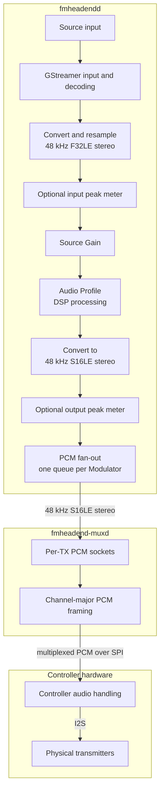

# Audio processing

FMheadend provides per-Source audio processing through configurable **Audio Profiles**. Each active digital Source has one processing pipeline, regardless of how many Modulators use its audio.

## 1. Processing overview

GStreamer handles input, decoding, channel conversion, resampling and the Audio Profile. DSP processing uses interleaved 48 kHz stereo `F32LE`; PCM delivered to `fmheadend-muxd` is interleaved 48 kHz stereo `S16LE`.

**Source Gain** precedes the Audio Profile. Every Modulator attached to the same Source receives the same processed audio. Analog Modulator input bypasses the host DSP path. Transmitter preemphasis, TX soft clipping and RF settings are configured separately in the Modulator.

## 2. Audio Profiles

An **Audio Profile** defines the audio processing chain applied to a Source. FMheadend includes read-only profiles and supports editable custom profiles.

### 2.1 Choosing a profile for a Source

Each Source offers two choices:

- **Use system default:** The Source uses whichever Audio Profile is currently selected as the global system default. Changing that default also changes the profile used by this Source.
- **Select a specific profile:** The Source always uses the selected profile, regardless of subsequent changes to the system default.

The system default can be a built-in or custom profile. It is selected from the **Audio Profiles** page.

Changes to a profile or its selection are applied to active Sources by rebuilding their audio pipelines. This can briefly interrupt audio. Stopped Sources remain stopped. If a rebuild fails, the saved setting remains in place and FMheadend reports that it could not be applied.

### 2.2 Built-in profile families

The bundled profiles provide starting points ranging from simple filtering to more intensive dynamics processing. Their exact settings can be inspected in the **Audio Profiles** page and may change between releases.

| Family | Processing approach | Variants |
|---|---|---|
| Bypass | No additional filtering or dynamics | Standard |
| Basic Filtering | High-pass and low-pass filters | Standard |
| Basic Clipper | Basic filtering and peak clipping | Standard |
| Basic AGC | Filtering, automatic level control and peak processing | Standard, TX Soft Clip ON |
| Basic Limiter | AGC and additional peak limiting | Standard, TX Soft Clip ON |
| Light | Gentler multiband dynamics and peak control | Normal / Loud, with or without TX Soft Clip ON |
| Moderate | Stronger multiband processing and peak control | Normal / Loud, with or without TX Soft Clip ON |

**Normal** and **Loud** target different levels of processing intensity. The editor shows the actual settings of each installed variant.

**`[TX Soft Clip ON]` profiles are tuned for Modulator Soft clipping enabled. Switch it on separately in each associated Modulator.**

### 2.3 TX soft clipping and modulation

The QN8007B's internal soft clipping is separate from the FMheadend DSP clipper. In experimental measurements, enabling it added approximately 4 dB of effective drive at lower levels, followed by frequency-dependent soft saturation associated with the chip's 50 µs preemphasis. Under heavy overdrive, measured peak deviation approached 75 to 79 kHz, with substantial distortion. It is not a transparent deviation limiter.

The bundled **Normal** and **Loud** profiles were evaluated around **0 to +3 dBr MPX power**, with observed peaks near **±75 kHz** under the tested conditions. Here, 0 dBr refers to the measured power of a sine wave producing ±19 kHz peak deviation. These results are not guaranteed for other programme material or transmitter configurations.

FMheadend's DSP is not a substitute for a calibrated professional broadcast audio processor. Verify actual modulation and spectral limits on the transmitted signal.

### 2.4 Creating and managing profiles

On the **Audio Profiles** page, either **Add Audio Profile** to create a new profile or **Clone** a built-in or custom profile. Configure its stages and save it. You can then assign it to an individual Source or set it as the global system default.

Built-in profiles are read-only. Custom profiles can be edited or deleted, provided they are not in use. The selected system-default profile cannot be deleted.

For advanced use, profiles are JSON files; a valid file must define all twelve stages and pass the backend's profile validation.

## 3. DSP signal chain

Each Audio Profile contains the following twelve processing stages, presented in signal-flow order. Optional processors can be set to **Off**.

| # | Stage | Purpose | Implementations |
|---:|---|---|---|
| 1 | Profile Input Gain | Sets the level entering the profile's processing stages | GStreamer Volume |
| 2 | High-pass filter (HPF) | Removes low-frequency content | Off, Chebyshev |
| 3 | Gate / Expander | Attenuates or reshapes low-level audio across frequency bands | Off, LSP Multiband Gate, LSP Multiband Expander |
| 4 | AGC / Leveller | Adjusts gain over time toward a target level | Off, LSP Autogain |
| 5 | Parametric EQ | Shapes the frequency response | Off, LSP Parametric EQ |
| 6 | Wideband Compressor | Controls dynamics across the full audio band | Off, LSP Compressor |
| 7 | Multiband Compressor | Controls dynamics separately in frequency bands | Off, LSP Multiband Compressor |
| 8 | Overall Gain | Sets the drive into the final peak-control stages | GStreamer Volume |
| 9 | Limiter | Controls peaks using lookahead gain reduction | Off, LSP Limiter, FM Headend Limiter |
| 10 | Low-pass filter (LPF) | Limits high-frequency audio content | Off, Chebyshev |
| 11 | Clipper | Applies final hard or soft peak clipping | Off, FM Headend Clipper |
| 12 | Output Trim | Attenuates the completed profile output | GStreamer Volume |

The Modulator's own **Soft clipping** option is not stage 11. It operates inside the transmitter, after host PCM processing.

## 4. DSP controls and ranges

The Audio Profile editor exposes the controls below. Ranges describe the supported settings, not recommended operating points. Built-in profiles supply their own parameters.

### 4.1 Gain and filters

| Stage | Controls and ranges |
|---|---|
| Profile Input Gain | Gain up to `+20 dB` |
| HPF / LPF | Cutoff `>0` and `<24,000 Hz`; even pole count `2..32` |
| Overall Gain | Gain up to `+20 dB` |
| Output Trim | Gain up to `0 dB` (attenuation only) |

The HPF and LPF use the GStreamer `audiocheblimit` element.

### 4.2 Gate, expander and compressors

Multiband processors support one to eight bands, with up to seven ascending crossovers from `10` to `20,000 Hz`.

| Processor | Controls and ranges |
|---|---|
| Multiband Gate | Per-band bypass; threshold `-60..0 dBFS`; reduction `0..72 dB`; attack `0..2000 ms`; hold `0..1000 ms`; release `0..5000 ms`; makeup `-60..60 dB`; zone `0..60 dB` |
| Multiband Expander | Per-band bypass and upward/downward mode; threshold `-60..0 dBFS`; ratio `1..100:1`; attack `0..2000 ms`; hold `0..1000 ms`; release `0..5000 ms`; knee `0..23.99 dB`; makeup `-60..60 dB` |
| Wideband Compressor | Threshold `-60..0 dBFS`; ratio `1..100:1`; attack `0..2000 ms`; release `0..5000 ms`; knee `0..23.99 dB`; makeup `-60..60 dB` |
| Multiband Compressor | Per-band bypass; threshold `-60..0 dBFS`; ratio `1..100:1`; attack `0..2000 ms`; release `0..5000 ms`; knee `0..23.99 dB`; makeup `-60..60 dB` |

### 4.3 AGC / Leveller

| Control | Range |
|---|---|
| Target loudness | `-60..0 LUFS` |
| Limit maximum gain | On / Off |
| Maximum gain | `0..108 dB` |
| Silence threshold | `-84..-36 LUFS` |
| Long-time Grow / Fall | `10..10000 ms` |
| Short-time Fall | `0.1..40 ms` |
| Short-time Grow | On / Off; `1..500 ms` when enabled |

### 4.4 Parametric EQ

The LSP EQ supports up to 16 bands, each configured as **Bell**, **Low shelf**, **High shelf** or **Notch**.

| Control | Range |
|---|---|
| Frequency | `10 Hz` to `<24,000 Hz` |
| Gain | `-35..35 dB` |
| Q | `0..100` |

### 4.5 Limiters

| Implementation | Controls and ranges |
|---|---|
| LSP Limiter | Threshold `-48..0 dBFS`; lookahead `0.1..20 ms`; attack `0.25..20 ms`; release `0.25..20 ms`; stereo link `0..100%` |
| FM Headend Limiter | Threshold `-60..0 dBFS`; lookahead `0..20 ms`; attack `0..20 ms`; release `1..1000 ms`; stereo link `0..100%`; detector weighting Off / `50 µs` / `75 µs`; true-peak detection On / Off |

The FM Headend Limiter's weighting applies to its detector, not to the programme signal. It does not change the transmitter's preemphasis. True-peak detection uses oversampling and adds CPU cost.

### 4.6 Clipper

| Control | Range |
|---|---|
| Threshold | `-60..0 dBFS` |
| FM weighting | Off / `50 µs` / `75 µs` |
| HF Correction | `-10..30 µs` |
| Clipping Mode | Hard / Soft |
| Soft Knee | `0..6 dB` (Soft mode) |

> The QN8007B applies mandatory 50 µs preemphasis after PCM processing, which can significantly increase high-frequency peaks and cause excessive FM deviation. Unlike conventional audio limiters and clippers, the FM Headend plugins provide preemphasis-aware peak control: their selectable FM weighting anticipates this high-frequency boost, allowing peaks to be limited or clipped before they reach the transmitter.

## 5. Plugin requirements

| Component | Provides |
|---|---|
| Standard GStreamer | Audio conversion, volume, filters and PCM handling |
| LSP LV2 plugins | Gate, expander, AGC, EQ, compressors and LSP limiter |
| `fmheadendlimiter` | FM Headend Limiter |
| `fmheadendclipper` | FM Headend Clipper |

The FMheadend limiter and clipper are separately distributed plugins. The backend does not require every DSP plugin to be installed, but profiles using an unavailable processor cannot run. The Audio Profile editor indicates which implementations are available.

Check plugin registration with `gst-inspect-1.0 fmheadendlimiter`, `gst-inspect-1.0 fmheadendclipper` or `gst-inspect-1.0 lsp-plug-in-plugins-lv2-autogain-stereo`. See [Installation](installation.md).

## 6. Troubleshooting

| Symptom | Check |
|---|---|
| An implementation is unavailable | Verify its GStreamer plugin with `gst-inspect-1.0` and check [Installation](installation.md). |
| `PROFILE_PLUGIN_UNAVAILABLE` or `INVALID_PROFILE` | Check the selected implementation, parameters and backend log. |
| A changed profile is saved but not audible | Check the Source's assigned profile and its pipeline restart status. |
| The Source is silent without a profile error | Check Source and PCM delivery status in [Operations](operations.md). |
| Unexpected distortion | Inspect the active profile, input levels, clipping and the Modulator's Soft clipping setting. |

## 7. Audio telemetry

Optional diagnostics can report input and output sample peaks, native LSP and FMheadend stage meters, limiter gain reduction and clipper activity for active Sources. Input peaks are measured before Source Gain; output peaks are measured after the DSP chain and final PCM conversion. These are sample-peak and plugin-native readings, not calibrated loudness or deviation measurements.

Start `fmheadendd` with `--audio-telemetry-socket PATH` to enable a local Unix socket emitting newline-delimited JSON. The optional `--audio-telemetry-hz` accepts `10..100 Hz` (50 Hz when omitted). Telemetry is not part of the WebUI or REST API.

Telemetry reads native stage meters and adds some processing overhead. A slow socket client is disconnected rather than accumulating an output backlog. See [Configuration](configuration.md).

## 8. CPU performance

**Complex processing profiles can consume substantial CPU time**, especially those using multiband dynamics, multiple native plugins or true-peak detection. Actual capacity depends on the Raspberry Pi model, the number of active Source pipelines and their chosen processing stages.

The DSP runs **once per Source**, not once per transmitter. Eight Modulators sharing one Source need only one DSP chain; eight independent Sources may require eight. On less powerful Raspberry Pi models, eight independent Sources running complex profiles may overload the system. Use lighter profiles or shared Sources where appropriate.

No fixed Source count or Raspberry Pi model-specific performance guarantee is provided without reproducible benchmarks.
