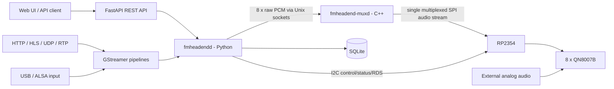
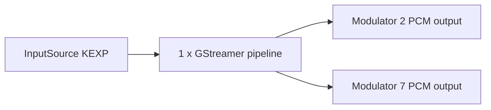
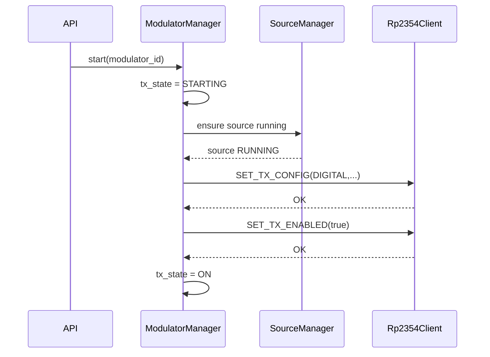
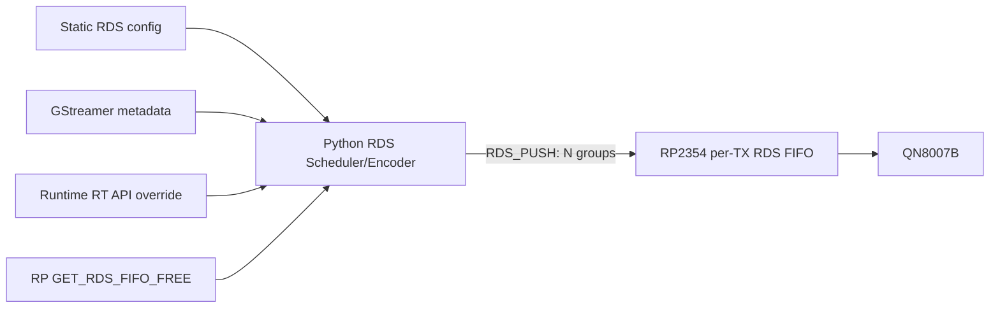
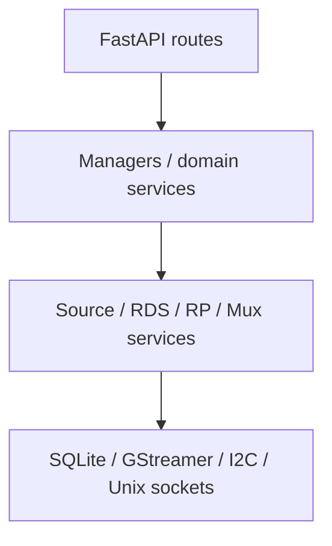

# fmheadend - Linux oldali szoftverarchitektúra és implementációs specifikáció

**Dokumentum státusza:** V1 tervezési specifikáció  
**Projekt munkaneve:** `fmheadend`  
**Fő Linux daemon:** `fmheadendd`  
**Audio SPI mux daemon:** `fmheadend-muxd`  
**Célgép:** Raspberry Pi Zero 2 W  
**Fejlesztőgép:** Raspberry Pi 4  
**Dátum:** 2026-09-10

---

# 1. A dokumentum célja

Ez a dokumentum a `fmheadend` projekt **Linux/Raspberry Pi oldali szoftverének kanonikus implementációs specifikációja**. Úgy készült, hogy egy másik fejlesztő vagy kódoló AI a dokumentum alapján a Linux oldali rendszert fokozatosan, minimális architekturális találgatással meg tudja valósítani.

A dokumentum nem az RP2354 firmware belső implementációját tervezi meg. Az RP2354 a Linux szoftver szempontjából egy külső, jól definiált hardveres szolgáltatás, amely:

- SPI-n multiplexelt PCM audio adatot fogad;
- I2C-n konfigurációs, állapot- és RDS parancsokat fogad/ad vissza;
- a 8 darab QN8007B fizikai modulátor hardverközeli kezelését elrejti a Linux elől.

Az RP2354 belső DMA-, PIO-, interrupt-, FIFO- és I2S implementációja **nem része ennek a dokumentumnak**. A Linux oldali interfész-contract azonban igen, mert annak kliensoldalát a Linux szoftvernek implementálnia kell.

## 1.1 Normatív nyelv

A specifikációban:

- **KÖTELEZŐ / MUST:** V1 architekturális döntés, implementációkor nem változtatható meg önkényesen.
- **AJÁNLOTT / SHOULD:** erősen preferált, de mérés vagy hardveres tapasztalat alapján módosítható.
- **OPCIONÁLIS / MAY:** nem szükséges az első működő verzióhoz.

## 1.2 Elsődleges fejlesztési cél

A V1 célja nem egy vizuálisan kifinomult webalkalmazás, hanem egy **stabil, unattended, setup-and-forget FM mini-headend**, amely hosszú ideig képes folyamatosan működni.

A prioritási sorrend:

1. stabilitás;
2. korrekt audioút;
3. helyes és rugalmas RDS;
4. kiszámítható hardvervezérlés;
5. diagnosztizálhatóság;
6. egyszerű, jól használható API;
7. web UI;
8. esztétika és extra kényelmi funkciók.

---

# 2. Rendszerkörnyezet és hardveres kontextus

A rendszer 8 darab QN8007B FM modulátort tartalmaz. A Raspberry Pi nem generál nyolc külön I2S adatfolyamot. Ehelyett a Linux oldal egyetlen multiplexelt SPI audiofolyamot küld egy RP2354 mikrokontrollernek, amely a hardver felé szétosztja az audioadatot.

Minden QN8007B analóg audio bemenete is ki van vezetve a nyákon. Emiatt egy modulátor audioforrása lehet:

- a Pi által szállított digitális PCM;
- közvetlen QN analóg bemenet.

A Linux oldali logikai architektúrának ezt az analóg bypass módot első osztályú üzemmódként kell kezelnie.

## 2.1 Magas szintű adat- és vezérlési síkok

A rendszer két lényegében független síkra válik szét:

- **Audio data plane:** GStreamer -> `fmheadendd` -> Unix socket -> `fmheadend-muxd` -> SPI -> RP2354.
- **Control plane:** Web/API -> `fmheadendd` -> I2C -> RP2354 -> QN8007B.

Az RDS a control plane része. Az RDS tartalmi logikája és schedulere Linux/Python oldalon fut; az RP2354 csak a már előállított groupokat fogadja és buffereli.

## 2.2 Architektúra diagram



---

# 3. Projekt- és szolgáltatásnevek

A projekt/repository neve **`fmheadend`** marad. A daemonokra külön név vonatkozik.

| Elem | Név | Megjegyzés |
|---|---|---|
| Projekt / repository | `fmheadend` | A teljes Linux oldali projekt |
| Fő Python daemon | `fmheadendd` | Orchestration, GStreamer, config, API, RDS, I2C |
| Audio mux daemon | `fmheadend-muxd` | PCM buffering és SPI adatpumpa |
| systemd unit | `fmheadendd.service` | Fő daemon |
| systemd unit | `fmheadend-muxd.service` | Audio mux daemon |
| Runtime könyvtár | `/run/fmheadend/` | Unix socketek |
| Adatbázis | `/var/lib/fmheadend/fmheadend.db` | SQLite |

A `d` suffix kizárólag a daemonokat jelöli; a projekt neve nem `fmheadendd`.

---

# 4. Fő komponensek és felelősségi határok

## 4.1 `fmheadendd`

A `fmheadendd` a rendszer fő orchestratora és control plane-je. Pythonban készül.

### KÖTELEZŐ feladatok

- persistent konfiguráció betöltése és mentése SQLite-ba;
- 8 fizikai modulátor logikai állapotának kezelése;
- `InputSource` objektumok kezelése;
- GStreamer pipeline-ok létrehozása és felügyelete;
- audio normalizálása a rendszer fix belső PCM formátumára;
- GStreamer metadata feldolgozása;
- PCM továbbítása a `fmheadend-muxd` felé;
- modulátor start/stop/config lifecycle orchestration;
- RP2354 I2C kliens;
- RDS encoder és online scheduler;
- RP RDS FIFO-k credit/free-space alapú feltöltése;
- runtime státusz aggregálása;
- FastAPI HTTP szerver és REST API;
- később a statikus web UI kiszolgálása;
- journald-kompatibilis logging.

### KÖTELEZŐEN nem a `fmheadendd` feladata

- sample-szintű audio DSP Python ciklusokban;
- a 8 PCM stream SPI-re multiplexálása;
- közvetlen SPI audio adatküldés;
- RP2354 firmware belső időzítése;
- közvetlen QN I2C/SEB hardverlogika;
- web UI authentikáció V1-ben.

## 4.2 `fmheadend-muxd`

Kis, determinisztikus C++ daemon. Feladata kizárólag a real-time-ish Linux audio transport.

### KÖTELEZŐ feladatok

- 8 fix formátumú PCM Unix socket fogadása;
- csatornánként bounded ring buffer;
- underrun esetén zero-fill;
- overrun esetén régi audio eldobása, hogy ne nőjön a latency;
- fix SPI audio frame-ek összeállítása;
- folyamatos SPI adatküldés az RP2354 felé;
- minimális control/status Unix socket biztosítása;
- audio transport számlálók és hibák szolgáltatása.

### Nem feladata

- GStreamer;
- SQLite;
- RDS;
- QN konfiguráció;
- I2C vezérlés;
- annak ismerete, hogy egy TX ON/OFF vagy ANALOG/DIGITAL módban van;
- samplerate-konverzió vagy hangprocesszálás.

## 4.3 RP2354 a Linux szemszögéből

Az RP2354 black-box periféria. A Linux két contractot ismer:

1. **SPI audio contract** - multiplexelt PCM fogadása.
2. **I2C control contract** - TX konfiguráció, státusz, RDS FIFO és debug műveletek.

Az RP belső implementációja nincs specifikálva ebben a dokumentumban.

---

# 5. Audio alapformátum és GStreamer stratégia

## 5.1 Fix belső PCM formátum

A Linux audioút kimeneti contractja V1-ben fix:

- **sample rate:** 48 000 Hz;
- **sample format:** signed 16-bit little endian (`S16LE`);
- **channels:** 2, stereo;
- **PCM layout:** interleaved L/R.

A forrás eredeti sample rate-je lehet 44.1 kHz, 48 kHz vagy más támogatott érték. A GStreamer a forrást a fix belső formátumra normalizálja.

### Indoklás

A 48 kHz-es fix domain leegyszerűsíti a teljes downstream transportot, az RP oldali audio interfészt és a hibakezelést. A netrádióknál gyakori 44.1 kHz -> 48 kHz sample rate conversion jó minőségű GStreamer resamplerrel elfogadható; az FM rendszer teljes minőségét nem ez fogja limitálni.

A sample-szintű SRC-t **nem Pythonban** kell implementálni.

## 5.2 GStreamer használata

A GStreamer a digitális inputok elsődleges ingest/decode/resample keretrendszere.

Egy tipikus pipeline logikailag:

```text
source -> demux/decode -> audioconvert -> audioresample -> optional processing ->
audio/x-raw,format=S16LE,rate=48000,channels=2 -> appsink
```

A konkrét pipeline source típustól függően változhat, de a kimeneti caps mindig azonos.

## 5.3 Támogatott input osztályok V1-ben

- `HTTP` - hagyományos HTTP/Icecast/Shoutcast és HLS URI is ebbe tartozik;
- `UDP` - raw vagy explicit formátumú UDP audio;
- `RTP` - RTP transport a megadott codec/payload paraméterekkel;
- `ALSA` - Linux ALSA capture device, tipikusan USB hangkártya;
Analog input is a per-Modulator audio mode, not an InputSource type.

**HLS nem külön `InputSource.type`.** HTTP/URI source-ként kezelendő.

## 5.4 Future source lehetőségek

Nem V1 követelmény, de az adatmodellnek ne zárja ki:

- M3U / file playlist;
- USB háttértárról zenelejátszás;
- Liquidsoap integráció;
- custom/local generator;
- külső processzor.

---

# 6. Persistent adatmodell

A persistent konfiguráció SQLite-ban tárolódik. Nincs külön adatbázis-szerver; egyetlen lokális fájl a canonical desired state.

A persistent config és a runtime state **szigorúan különválasztandó**.

## 6.1 `InputSource`

Az `InputSource` egy újrahasznosítható logikai audioforrás. Nem tartalmaz FM modulációs vagy RDS hardverbeállításokat.

### Közös mezők

| Mező | Típus | Kötelező | Jelentés |
|---|---|---:|---|
| `id` | integer | igen | SQLite primary key |
| `name` | string | igen | Emberi név, pl. `KEXP` |
| `type` | enum | igen | `HTTP`, `UDP`, `RTP`, `ALSA` |
| `config` | JSON object | igen | Type-specifikus config |
| `audio_profile_id` | nullable integer | nem | Opcionális audio processing profil |
| `gst_options` | JSON object | igen | Haladó GStreamer property override-ok; default `{}` |
| `timestamp` | datetime | igen | Utolsó mentés/módosítás időpontja |

Csak egyetlen timestamp szükséges. Ez setup-and-forget rendszer, nem audit/CRM.

InputSource configuration has no independent enable switch. Pipelines are demand-driven:
active DIGITAL modulators acquire/share a source; the last consumer releases it.

### 6.1.1 `HTTP` config

Javasolt mezők:

```json
{
  "uri": "https://example.org/stream",
  "buffer_ms": 3000,
  "connect_timeout_ms": 10000
}
```

- A `uri` kötelező.
- HLS `.m3u8` is ugyanebbe a típusba tartozik.
- ICY metadata kinyerése támogatandó, ha a stream szolgáltatja.

HTTP User-Agent has one configurable path: `gst_options.source["user-agent"]`.
If absent, the existing application default is `fmheadend/0.1.0`. Example source-level
options: `{"source": {"user-agent": "Station/2"}}`. This sets the HTTP element property
through the existing GStreamer source-setup callback; unsupported explicit properties
produce a probe/ingest error. No separate `config.user_agent` field is accepted.

HTTP source-test responses may include nullable `station_name`, extracted only from
transport `icy-name` metadata exposed by GStreamer HTTP header messages. It is separate
from now-playing `stream_title`/artist/title. Missing station identity remains null;
no URL guessing. This runtime probe value does not change source persistence.

Successful HTTP source-test responses may also include `input_bitrate_bps` from
existing GStreamer bitrate/nominal-bitrate tags. It is a reported estimate in bits/s,
not decoded PCM bitrate or measured download throughput. Missing/unusable metadata
returns null; the short probe is not extended to measure a byte-rate average. The UI
shows approximate whole decimal kb/s. No persistent configuration is introduced.

### 6.1.2 `UDP` config

V1-ben lehet szándékosan szűk.

```json
{
  "host": "0.0.0.0",
  "port": 5000,
  "multicast_group": null,
  "format": "S16LE",
  "sample_rate": 48000,
  "channels": 2
}
```

Raw UDP esetén a format/sample rate/channel count explicit, mert a transport nem feltétlenül önleíró.

### 6.1.3 `RTP` config

```json
{
  "host": "0.0.0.0",
  "port": 5004,
  "multicast_group": "239.1.1.1",
  "codec": "OPUS",
  "payload_type": 96
}
```

A V1 codec lista lehet korlátozott: `PCM`, `MP3`, `AAC`, `OPUS`.

### 6.1.4 `ALSA` config

```json
{
  "device": "hw:1,0",
  "sample_rate": 48000,
  "channels": 2
}
```

A capture formátumot a GStreamer normalizálja a fix belső PCM contractra.

## 6.2 `AudioProfile`

Az audio processinget nem az `InputSource` mezőivel kell szétszórni. Opcionális, újrahasznosítható `AudioProfile` tartozhat egy source-hoz.

V1-ben a modell maradjon egyszerű:

| Mező | Jelentés |
|---|---|
| `id` | Primary key |
| `name` | Profil neve |
| `gain_db` | Source-side gain, independent of processor; default 0 dB, maximum +20 dB |
| `eq_config` | Opcionális JSON, kezdetben minimális |
| `compressor_config` | Opcionális JSON |
| `limiter_config` | Opcionális JSON |
| `processor` | `NONE` (gain only, default) or `GST_BASIC` (native Basic DSP after common gain) |
| `basic_config` | Typed high-pass, three-band EQ, compressor, low-pass and limiter settings; see M7B4 |
| `advanced_options` | Opcionális advanced config |
| `timestamp` | Utolsó módosítás |

Gain always applies. Reserved DSP JSON is not interpreted. Basic uses only typed `basic_config`.
The backend chain and defaults are defined in `docs/milestone7b4.md`; frontend
integration is deferred. Gain is followed by Basic stages in F32LE/48 kHz/stereo,
then converted to the unchanged S16LE output contract. Missing plugins fail clearly.
All profile updates return 409 while a referencing source is assigned to a
Modulator whose current runtime TX state is ON. Stop affected transmitters before
saving, including renames. No live update or implicit restart is implemented. Referenced
profiles cannot be deleted. See `docs/milestone7b3.md` for compatibility details.

### V1 processing elv

A rendszernek nem kell Optimod-szintű teljes FM broadcast processzort implementálnia. Kívánatos, hogy legalább ezekhez legyen hook:

- gain;
- egyszerű EQ;
- compressor;
- limiter.

Multiband compressor, AGC, LADSPA/LV2 és hasonló funkciók később bővíthetők.

### Stereo Tool jövőbeli integráció

A pipeline architektúrája **ne zárja ki** egy külső Stereo Tool / `libStereoTool` processing backend későbbi beszúrását. Ez advanced/future funkció; különösen Pi Zero 2-n nem feltételezhető, hogy 8 teljes Stereo Tool instance futtatható.

## 6.3 `Modulator`

A `Modulator` a nyolc fizikai QN egyikét reprezentálja. Az `id` **fizikai azonosító 0..7**, nem tetszőleges auto-increment rekord.

| Mező | Típus | Jelentés |
|---|---|---|
| `id` | integer 0..7 | Fizikai QN index |
| `enabled` | bool | Desired boot/runtime ON állapot |
| `audio_mode` | enum | `DIGITAL` / `ANALOG`; default `DIGITAL` |
| `input_source_id` | nullable FK | Hozzárendelt `InputSource` |
| `frequency_khz` | integer | FM frekvencia kHz-ben |
| `stereo` | bool | Stereo/mono |
| `preemphasis_us` | enum 50/75 | Pre-emphasis |
| `rf_attenuation_db` | nullable number | Relative attenuation 0..22.5 dB in 1.5 dB steps; null until selected |
| `gain_mode` | AUTO / MANUAL | Default AUTO; QN AGC owns both gains in AUTO |
| `analog_gain_db` | number | Default 0.0 dB; signed tenths, final hardware representability checked by RP |
| `digital_trim_db` | 0 / 1 | Default 0; manual QN digital trim in dB |
| `soft_clipping` | boolean | Default false; independent QN soft clipping enable |
| `rds_enabled` | bool | RDS enable |
| `rds_pi` | string/uint16 | PI |
| `rds_ecc` | nullable uint8 | Extended Country Code; missing means unconfigured/null |
| `rds_af_khz` | integer list | Fixed ordered AF Method A frequencies; 87600..107900 kHz, 100 kHz raster, max 25 |
| `rds_ps` | JSON array | PS lista; 1 elem = statikus PS, több elem = dinamikus PS (DPS) |
| `rds_pty` | integer | PTY |
| `rds_tp` | bool | TP flag |
| `rds_rt` | string | Persistent fallback RadioText |
| `rds_rt_enabled` | bool | Transmit 2A independently of text/metadata contents; default true |
| `rds_rt_termination` | CR / PAD | CR-terminated short RT (default) or all 16 space-padded segments |
| `rds_metadata_to_rt` | bool | GStreamer metadata használható-e RT-nek |
| `timestamp` | datetime | Utolsó módosítás |

`Modulator.audio_mode` is persistent: `DIGITAL` (default) or `ANALOG`.
ANALOG selects this physical transmitter's dedicated analog jack, not a reusable
InputSource. There is no routing matrix. ANALOG always clears `input_source_id`
(including PATCH with an existing assignment); DIGITAL never restores a hidden
assignment and requires a configured digital source before start. Frequency validation
is unchanged. AudioProfile belongs only to digital InputSources. Analog mode creates
no GStreamer pipeline or PCM producer; the mux slot remains silence. RDS remains
Modulator-owned and independent of audio mode. RP audio_mode wire values remain 0/1.

Configuration PATCH is separate from lifecycle for all clients. A desired ON,
STARTING/ON, or active-source channel returns 409 MODULATOR_ACTIVE before any
configuration mutation or hardware action. Stop explicitly before editing and
start explicitly afterward. A PATCH attempting to change desired enabled state
returns 409 LIFECYCLE_REQUIRED; dedicated Start/Stop remain authoritative.
Stopped configuration changes are persisted for the next explicit start/recovery.

Modulators have no separate name field; physical ID 0..7 is their identity.

Fresh database seeding assigns one static PS entry FM TX <id> to each physical Modulator (IDs 0..7), with the model-default 5-second duration. The generic model uses neutral FM TX text; only the seed knows the physical ID. Reopening preserves stored PS configuration and timestamps without normalization.

### 6.3.1 PS és dinamikus PS

Az `rds_ps` mindig lista. Ha a listának egyetlen eleme van, az statikus PS; ilyenkor a `duration_s` értékét a backend figyelmen kívül hagyja. Ha több elem van, a lista dinamikus PS-ként (DPS) ciklikusan fut, és az egyes elemek `duration_s` értéke határozza meg a megjelenítési időt. A DPS tudatosan advanced, nem szabványos RDS-használat.

Statikus PS példa:

```json
[
  {"text": "KEXP", "duration_s": 5}
]
```

Dinamikus PS példa:

```json
[
  {"text": "RADIO123", "duration_s": 5},
  {"text": "BUDAPEST", "duration_s": 5},
  {"text": "98.1 FM ", "duration_s": 5}
]
```

A backend validálja, hogy minden PS elem legfeljebb 8 karakteres, RDS PS mezőként érvényes érték legyen. Egyetlen elem esetén a `duration_s` megtartható az egységes adatstruktúra miatt, de runtime viselkedésre nincs hatása.

### 6.3.2 RT forrás-prioritás

A runtime RT effektív tartalmának prioritása:

1. API runtime override;
2. GStreamer/stream metadata, ha `rds_metadata_to_rt == true`;
3. persistent `rds_rt` fallback.

Az API override opcionális TTL-t kaphat. Lejárat után automatikusan vissza kell állni a normál metadata/fallback logikára.

## 6.4 `SystemConfig`

Csak a teljes headendre vonatkozó technikai paraméterek kerüljenek ide.

Javasolt V1 mezők:

| Mező | Példa |
|---|---|
| `spi_device` | `/dev/spidev0.0` |
| `spi_clock_hz` | `25000000` |
| `i2c_device` | `/dev/i2c-1` |
| `rp2354_i2c_address` | implementation-defined |
| `rp_status_poll_interval_ms` | pl. 1000 |
| `web_listen_address` | `0.0.0.0` |
| `web_port` | `8080` |
| `log_level` | `INFO` |

A `48000/S16LE/stereo` V1-ben lehet kódoldali konstans; nem kell a normál UI-ban állíthatóvá tenni.

---

# 7. Runtime state modell

A runtime state nem persistent config és nem szükséges SQLite-ba írni.

## 7.1 `InputSourceStatus`

Javasolt mezők:

```json
{
  "source_id": 4,
  "state": "RUNNING",
  "codec": "AAC",
  "input_sample_rate": 44100,
  "input_channels": 2,
  "bitrate_bps": 128000,
  "stream_title": "Portishead - Roads",
  "reconnect_count": 2,
  "last_error": null
}
```

`state` enum:

- `IDLE`
- `CONNECTING`
- `BUFFERING`
- `RUNNING`
- `ERROR`

Reconnect alatt ismét `CONNECTING`; külön `RECONNECTING` nem szükséges.

## 7.2 `ModulatorStatus`

A V1 dashboardhoz szándékosan minimális.

```json
{
  "id": 0,
  "source_state": "RUNNING",
  "tx_state": "ON",
  "rf_attenuation_db": 6.0,
  "underruns": 0,
  "last_error": null
}
```

### `source_state`

For digital input this mirrors the active InputSource state. For ANALOG mode,
`ModulatorStatus.source_state` is null because no InputSource exists.

### `tx_state`

- `OFF`
- `STARTING`
- `ON`
- `ERROR`

Nincs külön `qn_ok` mező. A hardverhiba a `tx_state` és `last_error` segítségével jelenik meg.

### `rf_attenuation_db`

Relative RF attenuation: 0 is Maximum, followed by 15 levels in 1.5 dB steps
through 22.5 dB. This is configured/read-back attenuation, not an absolute or
measured RF output. Unavailable readback is null. RP firmware maps QN steps
without changing IPOW. Fresh Modulators have null attenuation; users must explicitly select a level.

### Tudatosan NINCS a V1 státuszban

- pillanatnyi VU / `level_dbfs`;
- current dynamic PS;
- current RadioText;
- részletes RDS carousel/cursor állapot.

## 7.3 `SystemStatus`

Példa:

```json
{
  "system_state": "RUNNING",
  "rp2354_state": "OK",
  "mux_state": "RUNNING",
  "spi_errors": 0,
  "i2c_errors": 0,
  "uptime_s": 86432,
  "cpu_percent": 24,
  "memory_percent": 31,
  "temperature_c": 51,
  "last_error": null
}
```

`system_state`:

- `STARTING`
- `RUNNING`
- `DEGRADED`
- `ERROR`
- `SHUTTING_DOWN`

`rp2354_state`:

- `OK`
- `UNRESPONSIVE`
- `ERROR`

`mux_state`:

- `RUNNING`
- `ERROR`

Egyetlen stream vagy egyetlen modulátor hibája tipikusan `DEGRADED`, nem teljes system `ERROR`.

---

# 8. `SourceManager` és GStreamer lifecycle

## 8.1 Egy pipeline per aktív source

Nem modulátoronként kell feltétlenül külön GStreamer pipeline. **Egy aktív digitális `InputSource` = egy GStreamer pipeline.**

Ha ugyanazt a source-ot több modulátor használja, ugyanaz az ingest/decode pipeline szolgálja ki őket.



## 8.2 Demand-driven lifecycle

Digitális pipeline akkor fusson, ha legalább egy aktív/enabled modulátor használja.

- első consumer megjelenik -> pipeline indul;
- további consumer -> ugyanaz a pipeline fan-out;
- egy consumer eltűnik -> pipeline marad, ha más használja;
- utolsó consumer eltűnik -> pipeline leáll.

`ANALOG` modulator soha nem hoz létre GStreamer pipeline-t.

## 8.3 Reconnect

Folyamatos hálózati streamnél automatikus reconnect KÖTELEZŐ.

Javasolt backoff:

```text
1 s -> 2 s -> 5 s -> 10 s -> 30 s -> 30 s -> ...
```

Stabil működés után a backoff resetelhető.

Streamhiba **nem TX hardware hiba**. Ha a source megszakad:

- `source_state` változik;
- a TX carrier maradhat ON;
- a muxd/RP digitális csendet kap azon a csatornán;
- reconnect fut a háttérben.

## 8.4 Appsink és backpressure

A GStreamer callback **soha nem blokkolhat SPI/I2C műveleten**.

A pipeline végén `appsink` használható. Az appsinkből érkező PCM-et gyorsan bounded queue-ba kell enqueue-olni, majd külön worker/async producer továbbítja a muxd felé.

A queue-k kapacitása korlátozott. Ha downstream megakad, nem épülhet fel korlátlan audio backlog.

## 8.5 Metadata

A SourceManager gyűjtse a GStreamer tageket és streamadatokat, például:

- StreamTitle;
- artist;
- title;
- codec;
- input sample rate;
- bitrate, ha rendelkezésre áll.

A SourceManager **nem ír közvetlenül RDS-t**. Metadata-change eseményt ad át az RDS logikának.

## 8.6 Advanced GStreamer opciók

A `gst_options` mező kontrollált property override-okat támogasson. Első körben ne tetszőleges pipeline-string legyen az alapértelmezett escape hatch.

Példa:

```json
{
  "source": {"timeout": 10000000000},
  "queue": {"max-size-time": 3000000000},
  "resample": {"quality": 4, "sinc-filter-mode": "full"}
}
```

Később opcionálisan létezhet `gst_pipeline_override`, de ez advanced, unsupported-by-default mód legyen.

---

# 9. `ModulatorManager`

A `ModulatorManager` a 8 fizikai modulátor magas szintű lifecycle orchestratora.

Az API route-ok nem beszélhetnek közvetlenül GStreamerrel vagy I2C-vel; minden modulátor-művelet a manageren keresztül menjen.

## 9.1 Digitális TX start



Az RF enable ne történjen meg addig, amíg a digitális source nincs használható állapotban.

## 9.2 Analóg TX start

- nincs GStreamer pipeline;
- nincs PCM producer;
- `SET_TX_CONFIG` audio mode = `ANALOG`;
- majd `SET_TX_ENABLED(true)`.

## 9.3 TX stop

Ajánlott sorrend:

1. RF/TX OFF;
2. szükséges hardveres standby;
3. source consumer reference elengedése;
4. ha nincs több consumer, SourceManager pipeline stop;
5. `tx_state = OFF`.

Az RF-et előbb kell kikapcsolni, mint az audio pipeline-t, hogy shutdownkor ne sugározzon véletlen audio-szemetet.

## 9.4 Source failure

`source_state` és `tx_state` külön fogalom.

Példa:

```text
tx_state = ON
source_state = CONNECTING
```

A carrier nem flappelhet minden rövid internetes streamhiba miatt.

## 9.5 Persistent desired state

A `Modulator.enabled` a kívánt állapot. Reboot vagy RP reset után a `fmheadendd` a persistent desired state alapján állítja helyre a rendszert.

---

# 10. `fmheadend-muxd` részletes Linux contract

## 10.1 Process modell

A `fmheadend-muxd` önálló C++ process, amelyet systemd indít és felügyel. A `fmheadendd` nem spawnolja.

## 10.2 PCM Unix socketek

A daemon hozza létre:

```text
/run/fmheadend/pcm0.sock
/run/fmheadend/pcm1.sock
...
/run/fmheadend/pcm7.sock
```

Javasolt socket type: `AF_UNIX`, `SOCK_STREAM`.

A socketen nincs audio header. A contract fix:

- S16LE;
- 48 kHz;
- 2 channels;
- interleaved L/R.

A socket index maga a modulátor indexe.

## 10.3 Bufferelés

Csatornánként külön bounded ring buffer.

Kiinduló ajánlás: kb. **100 ms** PCM/channel.

Egy stream adatsebessége:

```text
48000 * 2 channel * 2 byte = 192000 byte/s
```

100 ms kb. 19.2 kB/channel, nyolc csatorna kb. 154 kB.

A pontos méret belső config/konstans, nem normál web UI setting.

## 10.4 Underrun és overrun

**Underrun:** zero-fill, számláló növelése.

**Overrun:** a legrégebbi minták eldobása, számláló növelése. Élő audio esetén fontosabb az aktuális hang, mint az egyre növekvő latency.

## 10.5 Hiányzó producer

A muxd-nak nem kell tudnia, miért nincs PCM. Producer hiányakor digitális csendet küld.

Ez ugyanúgy igaz:

- stream reconnectre;
- kikapcsolt TX-re;
- analóg QN inputra;
- `fmheadendd` restart idejére.

## 10.6 Folyamatos SPI

V1-ben a muxd a saját indulásától folyamatosan küldje a fix-rate SPI audio streamet, akkor is, ha minden TX OFF vagy ANALOG.

Ez tudatos egyszerűsítés: nincs külön SPI start/stop/resync state machine.

## 10.7 Javasolt SPI audio frame

A Linux oldali implementáció számára a jelenlegi V1 javaslat:

- 128 stereo sample per TX per frame;
- 8 TX;
- 16 bit stereo;
- channel-major payload;
- egy frame kb. 2.667 ms audiót fed le;
- PCM payload 4096 byte;
- SPI clock kezdetben kb. 25 MHz;
- a CS tranzakcióhatárként használható;
- nincs V1 CRC.

Javasolt payload:

```text
uint32_le frame_counter
TX0: 128 x (int16_le L, int16_le R)
TX1: 128 x (int16_le L, int16_le R)
...
TX7: 128 x (int16_le L, int16_le R)
```

A `frame_counter` diagnosztikai célú. A pontos wire contractot a Linux muxd és RP firmware implementációja előtt közösen fagyasztani kell; az architektúra azonban erre a fix-frame elvre épül.

## 10.8 Mux control/status socket

```text
/run/fmheadend/mux-control.sock
```

Alacsony sebességű control/status, itt JSON request/response elfogadható.

Minimum V1 command:

```json
{"command":"get_status"}
```

Példa válasz:

```json
{
  "state": "RUNNING",
  "spi_ok": true,
  "frames_sent": 1456231,
  "channels": [
    {"id": 0, "underruns": 0, "overruns": 0},
    {"id": 1, "underruns": 3, "overruns": 0}
  ],
  "last_error": null
}
```

FIFO fill debug adat lehet, de a normál dashboardnak nem kell megjelenítenie.

---

# 11. RP2354 I2C API - Linux oldali contract

The authoritative binary specification is [RP2354 V1 protocol](rp2354-protocol.md).
This chapter describes component responsibilities; command IDs, offsets and exact
wire semantics are maintained only in that protocol document.

## 11.1 Alapelv

- Pi = I2C master.
- RP2354 = I2C slave.
- A Pi csak modulátor indexet (`0..7`) ismer.
- A Pi nem ismeri a QN közvetlen I2C címzését, SEB routingot vagy hardveres multiplexelést.
- A Linux oldalon kizárólag `Rp2354Client` foglalkozhat `/dev/i2c-*` hozzáféréssel és wire-format byte-okkal.

## 11.2 Minimalista request/response frame

V1-ben nincs sequence number. A Pi–RP I2C request és response CRC-16/CCITT-FALSE
ellenőrzést használ (poly 0x1021, init 0xFFFF, no reflection, xorout 0).
A CRC a header + payload byte-okra vonatkozik; a trailer little-endian, és nem
része a `length` mezőnek. A protokoll verziója továbbra is 1.

Request:

```text
command     u8
target      u8
length      u8
payload     length bytes
crc16_le    u16
```

Response:

```text
status      u8
length      u8
payload     length bytes
crc16_le    u16
```

`target`:

- `0..7` - fizikai modulátor;
- `0xFF` - global.

RP protocol V1 multibyte fields are little-endian as defined in [RP2354 V1 protocol](rp2354-protocol.md).

## 11.3 Status kódok

Minimum:

- `OK`
- `INVALID_COMMAND`
- `INVALID_TARGET`
- `INVALID_ARGUMENT`
- `BUSY`
- `QN_ERROR`
- `INTERNAL_ERROR`

## 11.4 Kötelező V1 műveletek

### `GET_INFO`

Global startup handshake.

Visszaadandó minimum:

- `protocol_version`;
- `firmware_version`;
- `hardware_revision`;
- `modulator_count`.

A Linux kompatibilitási checket végez.

### `SET_TX_CONFIG`

Egy modulátor teljes, konzisztens hardverconfigja egy műveletben.

Payload logikai mezői:

- `frequency_khz`;
- `rf_attenuation_db` (wire: `rf_attenuation_db_x10:u16`);
- `stereo`;
- `preemphasis_us`;
- `audio_mode` = `DIGITAL` / `ANALOG`;
- `rds_enabled`;
- `gain_mode`, `analog_gain_db`, `digital_trim_db`, `soft_clipping`.

A művelet **nem kapcsolja automatikusan ON állapotba a TX-et**.

Pre-release protocol V1 extends SET_TX_CONFIG to 15 bytes and GET_STATUS to 130 bytes.
The exact layouts and QN mapping contract live only in [RP protocol](rp2354-protocol.md).
AUTO ignores the persisted manual gains; MANUAL applies them through TXAGC_GVGA
(board-fixed RIN mapping in RP firmware) and TXAGC_GDB. Soft clipping maps to
TX_SFTCLPEN independently. Linux validates only finite signed-tenths wire range,
not a guessed RIN-specific range, and exposes no raw gain register codes.

Fresh Modulators use AUTO / 0.0 dB / 0 dB / false model defaults. No RIN is chosen.
Startup and recovery replay these fields through the same full TxConfig path,
before RDS synchronization and TX enable. Future firmware must advertise version 1 and implement the current expanded layouts. No M7B2 gain UI is part of this prerequisite.

### `SET_TX_ENABLED`

- target `0..7`;
- boolean ON/OFF.

### `GET_STATUS`

Egy hívással célszerű a globális és a 8 modulátor státuszt visszaadni.

A Linux számára modulátoronként szükséges minimum:

- `tx_state`;
- `rf_attenuation_db` vagy ennek reprezentálható hardveres megfelelője;
- `audio_underrun_count`;
- `rds_underrun_count`;
- `rds_fifo_free`;
- `last_error_code`.

Globálisan legalább:

- RP alive/uptime jellegű állapot;
- SPI audio link hiba/számláló, ha firmware szolgáltatja;
- globális error state.

### `GET_RDS_FIFO_FREE`

Global request for the free capacity of all eight RDS FIFOs in complete groups.
This supports future frequent capacity polling; GET_STATUS remains the full
hardware diagnostic snapshot. No scheduler or FIFO refill policy is part of M4.

### Diagnostic semantics

Global state describes a currently active fault; last_error_code is latched history.
The same distinction applies per channel. Historical errors alone are not active faults.
RP SPI audio link errors count RP-detected Pi-to-RP transport/frame failures, never
missing sources or generated silence. Without CRC, some bit corruption is undetectable.
Per-channel audio_underrun_count counts detected QN8007B I2S underrun flags, cleared
by firmware after detection. Multiple underruns between polls can collapse into one.
Linux mux underruns, RP SPI link errors and QN I2S underruns are distinct layers.
QN overflow has no dedicated status field. Pre-release protocol V1 exposes current analog
STATUS1.INSAT as `input_saturated: bool | null`; DIGITAL mode and unavailable RP
state produce null. This is not a latched error or counter.

### `RDS_PUSH`

Egy target modulátor RDS FIFO-jába több teljes RDS group feltöltése.

Logikai payload:

```text
group_count
group[0]
group[1]
...
```

A groupokat sorrendben kell értelmezni. A Linux csak annyit küld, amennyi a legutóbbi `rds_fifo_free` alapján elfér.

### `RDS_CLEAR`

Target modulátor RDS FIFO ürítése.

### Debug műveletek

- `QN_READ_REGISTER`
- `QN_WRITE_REGISTER`
- `RESET_ERROR_COUNTERS`
- `RP_SOFT_RESET`

A raw register access a bring-up és hibakeresés miatt szándékosan része V1-nek, de a normál user UI-ban advanced/debug területre való.

## 11.5 Python `Rp2354Client` felület

Javasolt magas szintű API:

```python
get_info()
get_status()
get_rds_fifo_free()
set_tx_config(modulator_id, config)
set_tx_enabled(modulator_id, enabled)
push_rds(modulator_id, groups)
clear_rds(modulator_id)
qn_read_register(modulator_id, register)
qn_write_register(modulator_id, register, value)
reset_error_counters()
reset()
```

A manager rétegek nem formázhatnak saját I2C packeteket.

---

# 12. RDS architektúra

## 12.1 Végleges V1 irány

A RDS **online schedulingja és encodingja Linux/Python oldalon történik**.

Az RP2354 modulátoronként egyszerű RDS group FIFO-t szolgáltat. Az RP nem ismeri és nem dönti el a 0A/2A/RT+/TMC group arányokat.

Ez azért fontos, mert a jövőben a Linux oldali RDS logika firmware-frissítés nélkül bővíthető.



## 12.2 V1 RDS funkciók

Kötelező:

- PI;
- ECC (nullable uint8, integer API);
- fixed AF Method A list;
- PS;
- PTY;
- TP;
- RadioText 2A;
- optional dynamic PS;
- metadata -> RT;
- API runtime RT override;
- RT Text A/B bit helyes kezelése tartalomváltozáskor;
- standard rövid RT lezárás kezelése;
- RP FIFO credit alapú feltöltés;
- underrun számlálás/státusz.

CT V1-ben **nem szükséges**.

RT+, TMC, ODA és más speciális groupok V1-ben nem kötelezők, de az architektúra ne zárja ki őket.

## 12.3 Online FIFO flow control

Normal refill uses GET_RDS_FIFO_FREE, not full GET_STATUS. Linux sends complete
information groups in atomic batches of at most 31, never exceeding fresh capacity.
BUSY retains the exact uncommitted batch; ACK alone commits scheduler advancement.
Ambiguous outcomes require a successful FIFO clear before coherent segment restart.

M5 policy, character conversion, standard reference and validation are documented
in [Milestone 5](milestone5.md). The quota allocator reserves at least 60% PS,
at least 30% RT when enabled, and exactly 2% ECC when enabled. Independently
configured future group quotas consume surplus; infeasible totals are rejected.
Remaining surplus goes to RT when enabled, otherwise PS. Without extensions the
PS/RT/ECC shares are 60/38/2%, 60/40/0%, 98/0/2%, or 100/0/0%. Smooth weighted
round robin interleaves groups continuously across FIFO batches; RT changes do
not override quotas. RT enabled alone determines 2A transmission, including empty
text. CR mode reserves a terminating 0x0D and sends only necessary segments;
PAD mode space-pads to 64 bytes and sends all 16. RT disable/format changes use
only that TX's existing acknowledged CLEAR boundary. The 100 ms refill loop and
2.0 s lookahead are internal policy, independent of UI polling and GStreamer callbacks.
M8.6B increased lookahead from 0.5 s to cover the existing 850 ms GET_STATUS wait
on the same serialized control executor, plus refill phase/jitter. It is Linux
buffering margin, not a QN hardware requirement; total group rate is unchanged.
Null ECC emits no 1A ECC. AF is a fixed user-ordered frequency list, never discovered.
Fresh Modulators default to ECC=null and AF=[].

## 12.4 Miért nem teljes offline carousel?

A tervezés során felmerült teljes, loopolható carousel feltöltése az RP-re. Ezt V1-ben elvetettük, mert:

- az RT változó hosszúsága megváltoztathatná a carousel struktúrát;
- hosszú dynamic PS esetén egy teljes carousel swap resetelhetné a DPS progresszt;
- a teljes carousel végének megvárása indokolatlanul késleltethetné az új RT-t;
- safe-swap indexek és fix slot-layout túl sok edge case-t és group-aránytalansági kockázatot hoznának;
- Linux oldali online scheduler egyszerűbb és jövőbiztosabb.

## 12.5 RT runtime prioritás

Effektív RT:

```text
API override (optional TTL)
        ↓ fallback
stream metadata
        ↓ fallback
persistent rds_rt
```

Az API override nem írja át automatikusan a persistent DB configot.

## 12.6 Dynamic PS

Dynamic PS támogatott advanced funkció. A schedulernek saját időalapú PS-állapotot kell kezelnie, de ez nem befolyásolhatja a digitális audio útvonalat.

---

# 13. REST API

## 13.1 Alapelv

FastAPI használata ajánlott. API prefix:

```text
/api/v1/
```

Az API elsődleges célja, hogy a rendszer **UI nélkül is teljesen vezérelhető és tesztelhető** legyen.

A FastAPI automatikus OpenAPI/Swagger dokumentációja az első fejlesztési mérföldkő fontos acceptance criterionja.

V1-ben nincs kötelező authentication. Feltételezés: helyi/lab LAN, nincs internetes port forward.

## 13.2 `InputSource` endpointok

```http
GET    /api/v1/sources
POST   /api/v1/sources
POST   /api/v1/sources/test
GET    /api/v1/sources/{id}
PATCH  /api/v1/sources/{id}
DELETE /api/v1/sources/{id}
POST   /api/v1/sources/{id}/test
GET    /api/v1/sources/{id}/status
```

### Source törlési constraint

Ha bármely `Modulator.input_source_id` hivatkozik rá, törlés `409 Conflict` legyen, ne csendes cascade.

### Source test

A source test endpoint nem unit tesztet jelent, hanem setup funkciót: a backend röviden megpróbálja megnyitni/dekódolni a megadott audioforrást, majd diagnosztikai eredményt ad vissza.

A `POST /sources/test` egy még el nem mentett source-konfigurációt kap request bodyban. Ez a web UI-ban a **Test** gomb alapja: a user beírhatja például a stream URL-t, kipróbálhatja, és csak sikeres teszt után mentheti el.

A `POST /sources/{id}/test` ugyanezt végzi egy már elmentett `InputSource` aktuális konfigurációjával.

Sikeres válasz például:

```json
{
  "ok": true,
  "codec": "AAC",
  "sample_rate": 44100,
  "channels": 2
}
```

A teszt egyik változata sem módosíthat persistent assignmentet vagy konfigurációt.

## 13.3 Modulator endpointok

A modulátorok fix hardverentitások; nincs create/delete.

```http
GET   /api/v1/modulators
GET   /api/v1/modulators/{id}
PATCH /api/v1/modulators/{id}

POST  /api/v1/modulators/{id}/start
POST  /api/v1/modulators/{id}/stop
POST  /api/v1/modulators/start-all
POST  /api/v1/modulators/stop-all
```

A `PATCH` configot módosít. A `start/stop` explicit action.

Az API route a `ModulatorManager` szolgáltatását hívja, nem közvetlen I2C/GStreamer függvényt.

## 13.4 RDS runtime API

V1-ben legalább RT override:

```http
PUT    /api/v1/modulators/{id}/rds/rt
DELETE /api/v1/modulators/{id}/rds/rt
```

Példa:

```json
{
  "text": "Special programme tonight",
  "ttl_s": 120
}
```

TTL opcionális. Törlés vagy TTL lejárat után visszaáll a metadata/fallback RT.

Ez a külső script/Liquidsoap/custom automation integráció alapja is lehet.

## 13.5 AudioProfile endpointok

```http
GET    /api/v1/audio-profiles
POST   /api/v1/audio-profiles
GET    /api/v1/audio-profiles/{id}
PATCH  /api/v1/audio-profiles/{id}
DELETE /api/v1/audio-profiles/{id}
```

V1 implementation minimális lehet; az adatmodell jövőbővíthető.

## 13.6 Status endpoint

A dashboard fő polling endpointja:

```http
GET /api/v1/status
```

Példa:

```json
{
  "system": {
    "system_state": "RUNNING",
    "rp2354_state": "OK",
    "mux_state": "RUNNING",
    "uptime_s": 123456,
    "cpu_percent": 27,
    "memory_percent": 34,
    "temperature_c": 52,
    "last_error": null
  },
  "modulators": [
    {
      "id": 0,
      "source_state": "RUNNING",
      "tx_state": "ON",
      "rf_attenuation_db": 6.0,
      "underruns": 0,
      "last_error": null
    }
  ]
}
```

A böngészőnek elegendő kb. 5 másodpercenként pollolni. WebSocket V1-ben nem szükséges.

A browser request ne generáljon közvetlen I2C transactiont; a daemon saját status cache-t tart.

## 13.7 System endpointok

```http
GET   /api/v1/system/config
PATCH /api/v1/system/config
GET   /api/v1/system/info
```

`/system/info` példa:

```json
{
  "fmheadend_version": "0.1.0",
  "rp_protocol_version": 1,
  "rp_firmware_version": "...",
  "hardware_revision": "...",
  "modulator_count": 8
}
```

## 13.8 Debug endpointok

Külön namespace:

```text
/api/v1/debug/
```

Minimum lehetőségek:

- raw RP status;
- QN register read;
- QN register write;
- error counter reset.

Ezek advanced fejlesztői funkciók, nem normál dashboard elemek.

## 13.9 Egységes hibaválasz

Javasolt forma:

```json
{
  "error": "INVALID_FREQUENCY",
  "message": "Frequency must be 76000..108000 kHz on the 50 kHz hardware raster."
}
```

Az API ne használjon endpointonként eltérő error shape-et.

Ajánlott HTTP státuszok:

| HTTP | Jelentés |
|---|---|
| 200/204 | siker |
| 400 | hibás request |
| 404 | nem létező resource |
| 409 | state/resource conflict |
| 422 | validation error |
| 500 | belső szoftverhiba |
| 503 | hardver/control dependency nem elérhető |

---

# 14. Web UI - későbbi vázlat

A production UI nem része az első vibe-coding milestone-nak. A backendnek UI nélkül is teljesen használhatónak kell lennie.

V1 UI később lehet szándékosan fapados.

## 14.1 Dashboard

8 modulátor sor/kártya:

- physical modulator ID (0..7);
- frekvencia;
- hozzárendelt source;
- TX state;
- source state;
- relative RF attenuation;
- underrun count;
- last error;
- start/stop.

Nincs szükség realtime VU meterre.

## 14.2 Configuration

Javasolt oldalak/tabok:

- Sources;
- Modulators;
- Audio Profiles;
- System.

Modulator oldalon legalább:

- source dropdown;
- frequency;
- stereo/mono;
- 50/75 us;
- RF level;
- RDS enable;
- PI;
- ECC (nullable uint8, integer API);
- fixed AF Method A list;
- PS;
- dynamic PS;
- PTY/TP;
- fallback RT;
- metadata-to-RT toggle.

## 14.3 Advanced/Debug

- RP firmware/protocol info;
- raw QN register read/write;
- transport/error counters;
- log/debug információk.

V1-ben nincs login/auth UI.

---

# 15. systemd, startup, shutdown és recovery

## 15.1 Két külön systemd service

```text
fmheadend-muxd.service
fmheadendd.service
```

A `fmheadendd` függjön a muxd-tól:

```ini
Wants=fmheadend-muxd.service
After=fmheadend-muxd.service network-online.target
```

Mindkettőnél javasolt:

```ini
Restart=on-failure
RestartSec=2
```

A `fmheadendd` **nem spawnolja** a muxd-t.

M6A clarification: Wants/After deliberately keeps the HTTP service alive when
muxd stops. Application startup uses a serialized hardware synchronization: GET_INFO,
disable all channels, apply configured TX settings, clear/reset RDS boundaries,
restore desired ON channels, then verify current status. Unconfigured channels
remain OFF. Reconnect does not imply hardware state loss and never automatically
replays this sequence. Read failures retain stale observations; uncertain RDS
commands recover only the affected FIFO, uncertain enable writes reapply only
the target state, and uncertain configuration writes reconcile only their TX.
Suspicious uptime values or status mismatches do not justify global restoration.
Shutdown never overwrites persistent desired enabled state.
See [Milestone 6A](milestone6a.md) for deployment and exact lifecycle semantics;
Zero 2 W stress/performance validation is deferred to M6B.

## 15.2 Startup sorrend

Javasolt:

1. SQLite open és schema/version check;
2. persistent config betöltése;
3. muxd control kapcsolat;
4. RP2354 `GET_INFO`;
5. protocol/firmware compatibility check;
6. RP status lekérés;
7. persistent modulator config előkészítése/alkalmazása;
8. szükséges digitális InputSource pipeline-ok indítása;
9. `enabled` modulátorok kontrollált startja;
10. system state -> `RUNNING` vagy `DEGRADED`.

A HTTP API indulhat a startup alatt is; ilyenkor `system_state = STARTING`.

## 15.3 RP communication loss and scoped recovery

Communication health is separate from hardware synchronization. Transport loss
marks observations stale and the system DEGRADED, while RF/audio and persistent
desired state remain unchanged. A shared bounded backoff coalesces retries.

After communication returns, GET_INFO checks compatibility and fresh reads update
observations. Reconnect never implies OFF/config/CLEAR/ON replay. GET_STATUS or
GET_RDS_FIFO_FREE failures perform no hardware restoration. Suspicious uptime
values and per-TX mismatches do not prove global state loss.

Uncertain RDS_PUSH/CLEAR fences only that TX's RDS until an acknowledged CLEAR,
then immediately refills its existing two-second lookahead. NOT_SENT keeps the
batch; ambiguous PUSH is never replayed. Uncertain SET_TX_ENABLED reapplies only
the target's desired ON/OFF. Uncertain SET_TX_CONFIG reconciles only that TX.

Full restoration is limited to application startup in the current daemon. Any
future explicit reset path must establish actual global state loss before using
it. V1 has no boot identifier; this milestone adds no reset-detection heuristics.
The database and session STOP ALL holds remain the desired-state authority.

Explicit START/STOP may reacquire the control session once only when metadata
proves the requested command was NOT_SENT (open/backoff/implicit GET_INFO failure).
The existing shared backoff is honored; bulk operations share one extra attempt.
Ambiguous command responses and valid RP rejections are never retried by this
allowance. No synchronous GET_STATUS is added to a lifecycle request.

A valid OFF ACK confirms STOP even if later mux/source cleanup fails: the response
remains HTTP 200/OFF, with cleanup diagnostics in `last_error` and retained source
ownership where release failed. During incomplete startup synchronization, changed
desired state revisits only the affected target's obsolete acknowledged enable
state before final observation. See [M6A](milestone6a.md) for the exact boundaries.

## 15.4 muxd kiesés

- `mux_state = ERROR`;
- `fmheadendd` control és PCM socket reconnectet próbál;
- GStreamer oldali bounded queue-k nem nőhetnek végtelenre;
- muxd visszatérése után a PCM flow automatikusan helyreáll.

## 15.5 Streamhiba

Hálózati source hibája nem állítja le a TX hardvert. A source reconnectel, a digitális audio közben silence.

## 15.6 Graceful shutdown

Ajánlott sorrend:

1. `system_state = SHUTTING_DOWN`;
2. minden TX OFF;
3. RDS folyamat leállítása/clear ahol szükséges;
4. GStreamer pipeline-ok stop;
5. mux/socket kapcsolatok lezárása;
6. DB close;
7. process exit.

Az RF kikapcsolása legyen a shutdown elején.

## 15.7 Logging

V1-ben journald az egyetlen kötelező log backend.

- stdout/stderr -> systemd/journald;
- log levels: DEBUG, INFO, WARNING, ERROR;
- normál: INFO;
- minden releváns log tartalmazzon source/modulator azonosítót.

Példák:

```text
INFO  source 3 connected: AAC 44100 Hz
INFO  modulator 2 started at 98.1 MHz
WARN  source 3 disconnected, retry in 5 s
ERROR RP2354 I2C communication failed
```

Nem kell V1-ben saját log file rotation vagy SQLite log history.

## 15.8 Watchdog

V1-ben nem szükséges saját watchdog daemon. A systemd restart policy elegendő első körben. Később `WatchdogSec` / `sd_notify` hozzáadható.

---

# 16. SQLite viselkedés és desired/actual state

## 16.1 Miért SQLite

A rendszer már nem csak 8 fix JSON konfigurációból áll. Külön vannak:

- reusable input source-ok;
- modulátorok és source assignment;
- audio profile-ok;
- későbbi playlist/preset lehetőségek.

SQLite továbbra is egyszerű, lokális, egyfájlos megoldás, de jobban kezeli a relációkat és későbbi bővítést, mint egy saját JSON adatbázis.

## 16.2 Desired vs actual

Kritikus alapelv:

- SQLite = **desired state**;
- runtime status = **actual state**.

Példa:

```text
desired frequency = 98.1 MHz
actual hardware state = ERROR / RP unavailable
```

A desired configot nem kell visszagörgetni csak azért, mert pillanatnyilag nem sikerült hardverre alkalmazni.

## 16.3 Config update sorrend

Ajánlott:

1. API input validation;
2. SQLite transaction commit;
3. runtime apply;
4. ha runtime apply hibázik, actual state/error frissül;
5. későbbi recovery újrapróbálja a persistent desired state alkalmazását.

## 16.4 Schema version

The current pre-V1 SQLite format is schema version 1. There is no released database
format and no supported external legacy database. Startup reads PRAGMA user_version:
0 creates the complete current schema and model-default seeds in one atomic
transaction, then sets version 1; 1 opens normally without rewriting configuration;
any other nonzero version fails with "Unsupported pre-release database schema <n>.
Recreate the database." No downgrade, recovery, or historical migration runs.

The current tables are audio_profiles, sources, modulators, and system_config
(with SQLite's internal sqlite_sequence for generated profile/source IDs).
Sources reference AudioProfiles and Modulators reference Sources, both with
ON DELETE RESTRICT. Modulator IDs are constrained to 0..7; triggers prohibit
deletion and ID updates. Every open validates exactly the eight required IDs.
Initialization seeds those Modulators and SystemConfig directly from current
models; it creates no AudioProfiles or Sources.

Before the first supported release, incompatible changes may reset this pre-release
format and development databases may need recreation. Developers/operators may
delete old development DB files; startup never silently resets them. Do not
accumulate permanent compatibility migrations for unreleased formats.

After a released database format exists, increment schema versions normally,
preserve supported user data, and write explicit tested migrations between released
formats. Backward-compatible migrations have not started yet; no migration framework
is required now.

---

# 17. Repo layout

Javasolt monorepo:

```text
fmheadend/
├── daemon/                 # Python főprogram: fmheadendd
│   ├── app.py
│   ├── config.py
│   ├── database.py
│   ├── models/
│   ├── sources/
│   ├── gstreamer/
│   ├── modulators/
│   ├── rds/
│   ├── rp2354/
│   ├── mux/
│   ├── status/
│   ├── api/
│   ├── tests/
│   └── pyproject.toml
│
├── muxd/                   # C++ audio/SPI daemon: fmheadend-muxd
│   ├── src/
│   ├── include/
│   ├── tests/
│   └── CMakeLists.txt
│
├── webui/
│   └── ... later
│
├── systemd/
│   ├── fmheadendd.service
│   └── fmheadend-muxd.service
│
├── docs/
│   ├── architecture.md
│   ├── api.md
│   └── rp2354-protocol.md
│
└── README.md
```

A forrásmappák jelentése szándékosan egyszerű: `daemon/` tartalmazza az `fmheadendd` Python főprogramot, `muxd/` pedig az `fmheadend-muxd` C++ audio/SPI daemont. Nincs további egymásba ágyazott `fmheadend` vagy `fmheadendd` forrásmappa.

Az RP firmware lehet külön repository. A Linux monorepo nem függhet a firmware source tree jelenlététől.

---

# 18. Technológiai stack

## 18.1 Backend

- Python 3;
- `asyncio`;
- FastAPI;
- Pydantic;
- GStreamer Python bindings;
- Python `sqlite3` vagy vékony adat-hozzáférési réteg;
- Linux `i2c-dev`/SMBus kompatibilis kliens;
- standard logging -> journald.

Nem szükséges ORM-heavy megoldás. Ha ORM használatos, legyen könnyű és ne dominálja az architektúrát.

## 18.2 Mux daemon

- C++;
- CMake;
- POSIX Unix sockets;
- Linux spidev;
- bounded ring buffers;
- egyszerű RAII/threading.

Nem kell nagy C++ framework.

## 18.3 Frontend

Nincs V1 stack freeze. Lehet nagyon egyszerű HTML/CSS/TypeScript vagy könnyű frontend framework. A backend API nem függhet a frontend technológiájától.

---

# 19. Belső modulstruktúra és dependency szabályok

Javasolt Python csomagstruktúra:

```text
models/
    input_source.py
    modulator.py
    audio_profile.py
    runtime_status.py

sources/
    manager.py
    gst_pipeline.py

modulators/
    manager.py

rds/
    encoder.py
    scheduler.py
    metadata.py

rp2354/
    client.py
    protocol.py

mux/
    client.py

api/
    sources.py
    modulators.py
    status.py
    system.py
    debug.py
```

### Dependency irány



KÖTELEZŐ szabályok:

- API route nem ír közvetlen SQL-t;
- API route nem ír közvetlen I2C-t;
- API route nem manipulál közvetlen GStreamer elementet;
- `ModulatorManager` orchestrationt végez;
- `SourceManager` source lifecycle-t végez;
- `Rp2354Client` az egyetlen RP wire-protocol implementáció;
- `MuxClient` az egyetlen mux control/PCM IPC absztrakció.

---

# 20. Tesztelhetőség és mockok

Hardver nélkül is fejleszthető backend KÖTELEZŐ.

Javasolt interface-ek:

```text
Rp2354Client
├── RealRp2354Client
└── MockRp2354Client

MuxClient
├── UnixMuxClient
└── MockMuxClient

SourcePipeline
├── GstPipeline
└── MockPipeline
```

Példa unit test digitális modulátorra:

```text
start TX3
-> source pipeline elindult
-> SET_TX_CONFIG(DIGITAL) meghívódott
-> SET_TX_ENABLED(true) meghívódott
-> tx_state ON
```

Analóg source test:

```text
start TX3 with ANALOG audio mode
-> GStreamer pipeline NEM indul
-> SET_TX_CONFIG(ANALOG)
-> SET_TX_ENABLED(true)
```

A mock backendből az OpenAPI/Swagger API az első milestone-ban valódi hardver nélkül teljesen tesztelhető legyen.

---

# 21. Implementációs mérföldkövek

## Milestone 1 - Backend skeleton + API, mock hardverrel

**Ez legyen az első vibe-coding feladat.**

Kötelező eredmény:

- `fmheadendd` Python package;
- FastAPI server;
- SQLite schema initialization és version check;
- `InputSource` CRUD;
- 8 fix `Modulator` config;
- `AudioProfile` alapmodell;
- runtime status modellek;
- mock RP2354;
- mock muxd;
- `ModulatorManager` start/stop lifecycle;
- `/api/v1/status`;
- source test endpointok (elmentett és még el nem mentett source konfigurációhoz);
- runtime RT override + TTL;
- egységes error model;
- automatikus OpenAPI/Swagger docs;
- unit tesztek.

**Nem kell még:** valódi GStreamer, I2C, SPI, production UI.

### Milestone 1 acceptance criteria

- `fmheadendd` indul egy sima Linux gépen/Pi-n hardver nélkül mock módban;
- `/docs` alatt minden fontos API interaktívan hívható;
- a 8 modulátor configolható és start/stop mockolható;
- source create/update/delete és mindkét source test mód működik;
- invalid config korrekt HTTP errorral tér vissza;
- restart után persistent config megmarad;
- unit test suite zöld.

## Milestone 2 - GStreamer integration

- HTTP/HLS ingest;
- UDP;
- RTP;
- ALSA;
- ANALOG special case;
- decode;
- audioconvert/resample;
- 48k/S16LE/stereo caps;
- appsink;
- bounded output queue;
- metadata;
- reconnect;
- egy source -> több modulator fan-out;
- gain és basic AudioProfile hook;
- valós source test endpoint.

## Milestone 3 - `fmheadend-muxd`

- 8 Unix PCM socket;
- bounded ring buffers;
- zero-fill;
- overrun/underrun counters;
- fixed SPI frame builder;
- control/status socket;
- mock SPI backend;
- spidev backend;
- unit/integration tests.

## Milestone 4 - RP2354 client

- Linux I2C transport;
- wire protocol;
- `GET_INFO`;
- `GET_STATUS`;
- `SET_TX_CONFIG`;
- `SET_TX_ENABLED`;
- `RDS_PUSH`;
- `RDS_CLEAR`;
- raw QN register debug;
- RP reconnect/recovery.

## Milestone 5 - RDS

- 0A PS and fixed VHF AF Method A;
- 1A variant 0 ECC;
- 2A RT;
- PI;
- ECC (nullable uint8, integer API);
- fixed AF Method A list;
- ECC;
- PTY;
- TP;
- dynamic PS;
- metadata -> RT;
- runtime API RT override;
- TTL;
- RT Text A/B helyes váltás;
- online scheduler;
- RP FIFO free-space alapú töltés;
- underrun monitoring.

## Milestone 6 - Integration és reliability

- systemd units;
- desired-state startup restore;
- muxd reconnect;
- RP reset recovery;
- network stream reconnect;
- journald logging;
- `DEGRADED` állapot;
- hosszú stress test;
- Pi Zero 2 CPU/RAM/temperature benchmark;
- 8 párhuzamos stream + SRC + SPI + RDS + API teszt.

## Milestone 7 - Web UI

Csak az API stabilizálása után:

- dashboard;
- sources;
- modulators;
- audio profiles;
- advanced/debug.

---

# 22. Pi Zero 2 teljesítményelvárások

A rendszer célplatformja Raspberry Pi Zero 2 W, ezért a Pi 4-en végzett fejlesztés során nem szabad a Pi 4 erőforrástöbbletére építeni.

KÖTELEZŐ elvek:

- Python ne végezzen sample-szintű DSP-t;
- decode/resample GStreamer natív kódban;
- muxing C++ daemonban;
- bounded queue-k;
- nincs felesleges 24-bit PCM;
- 48 kHz / 16-bit / stereo fix;
- performance benchmark a Pi Zero 2-n Milestone 6 előtt production readinesshez.

A legnagyobb várható terhelés a 8 párhuzamos codec decode + SRC + esetleges DSP, nem maga a kb. 12.288 Mbit/s nyers 8-stereo PCM adatsebesség.

---

# 23. Tudatosan kihagyott V1 funkciók

A következők **nem részei a V1 kötelező scope-nak**:

- teljes production web UI az első milestone-ban;
- authentication/user management;
- WebSocket status stream;
- realtime VU meter;
- CT RDS;
- RT+;
- TMC;
- ODA custom groupok;
- full multiband broadcast processor;
- 8 x Stereo Tool;
- M3U/local playlist engine;
- Liquidsoap natív integráció;
- internetre nyitott remote management;
- Docker/Kubernetes/Redis/RabbitMQ;
- külön logging database;
- saját watchdog daemon;

---

# 24. Biztonság és deployment feltételezések

V1-ben nincs UI/API login.

Feltételezés:

- a headend helyi, megbízható LAN-on fut;
- routeren nincs nyers internetes port forward;
- ha később remote access kell, VPN/Tailscale/WireGuard jellegű megoldás preferált;
- raw debug QN register write csak advanced/debug felületből érhető el.

---

# 25. AI/vibe-coding handoff szabályok

A következő szabályokat a kódoló AI-nak explicit át kell adni.

## 25.1 Architektúrát ne tervezze újra

**Do not redesign the architecture unless explicitly requested.**

Különösen:

- ne olvassza össze a `fmheadendd` és `fmheadend-muxd` processzt;
- ne vigye a PCM muxingot Pythonba;
- ne cserélje le a GStreamert önkényesen VLC/FFmpeg process farmra;
- ne cserélje le az SQLite-ot szerveres DB-re;
- ne vezessen be Redis/RabbitMQ/Kafka/containers orchestration megoldást;
- ne tegyen WebSocketet csak azért, mert modernebb;
- ne építsen auth rendszert V1-ben;
- ne implementáljon RP firmware belső viselkedést találomra;
- ne keverje össze a persistent desired state-et a runtime actual state-tel;
- ne indítson egy GStreamer pipeline-t modulátoronként, ha több modulátor ugyanazt az `InputSource`-ot használja;
- ne blokkolja a GStreamer streaming callbacket I2C/SPI/socket várakozással;
- ne generáljon sample-szintű audio processing loopokat Pythonban.

## 25.2 Kis, ellenőrizhető lépések

Minden milestone végén legyen:

- futtatható program;
- unit/integration teszt;
- rövid README/frissített docs;
- reprodukálható indítási parancs;
- egyértelmű known limitations lista.

## 25.3 Mock-first

Az első backend implementáció hardver nélkül legyen tesztelhető. Ne várjon a PCB vagy RP firmware elkészültére.

## 25.4 API-first

A UI előtt az API legyen stabil. A frontend ugyanazt a publikus REST API-t használja, amit a Swagger és külső kliens is.

---

# 26. Első vibe-coding feladat - ajánlott prompt

Az alábbi feladat adható első körben egy másik kódoló AI-nak:

> Implement Milestone 1 of the `fmheadend` Linux backend according to this specification. Build the `fmheadendd` Python service with FastAPI, Pydantic models, SQLite persistence, schema versioning, eight fixed Modulator entities, InputSource CRUD, basic AudioProfile persistence, runtime status objects, mock RP2354 and mux clients, ModulatorManager lifecycle, source test mock, runtime RDS RT override with optional TTL, unified API error responses, and OpenAPI/Swagger documentation. Hardware access, real GStreamer, SPI, I2C and the production web UI are explicitly out of scope for this milestone. Keep boundaries mockable and do not redesign the architecture.

### Első körben elvárt demonstráció

1. service startup;
2. `/docs` működik;
3. source létrehozása;
4. source modulátorhoz rendelése;
5. modulátor config módosítás;
6. start/stop;
7. `/status` értelmes mock állapotot ad;
8. RT override TTL-lel működik;
9. restart után config megmarad;
10. test suite sikeres.

---

# 27. Nyitott, de nem blokkoló technikai pontok

Ezeket nem kell az első backend milestone előtt véglegesíteni:

1. RP2354 I2C slave cím konkrét értéke.
2. I2C IDs and layouts are defined in [RP2354 V1 protocol](rp2354-protocol.md).
3. SPI frame pontos wire header véglegesítése.
4. RF units: relative `rf_attenuation_db`, 16 levels; QN step mapping belongs to RP firmware without changing IPOW.
5. GStreamer alapértelmezett resampler quality mérés Pi Zero 2-n.
6. Basic compressor/limiter konkrét pluginja.
7. muxd ring buffer végleges mérete.
8. RDS FIFO méret az RP firmware-ben.
9. RDS scheduling policy is defined in [Milestone 5](milestone5.md).
10. frontend technológia.

Ezeket mérés vagy a firmware contract véglegesítése alapján lehet lezárni anélkül, hogy a fő architektúra változna.

---

# 28. Rövid döntési összefoglaló

| Téma | V1 döntés |
|---|---|
| Cél Linux gép | Raspberry Pi Zero 2 W |
| Fejlesztés | Raspberry Pi 4 |
| Projekt neve | `fmheadend` |
| Fő daemon | `fmheadendd`, Python |
| Audio mux | `fmheadend-muxd`, C++ |
| Ingest/decode/SRC | GStreamer |
| Belső PCM | 48 kHz, S16LE, stereo |
| Pi -> RP audio | egyetlen multiplexelt SPI stream |
| Pi -> RP control | I2C request/response |
| QN analog input | támogatott source mód |
| Persistent storage | SQLite |
| Source / Modulator | külön entitások, FK assignment |
| HLS | HTTP source része |
| Audio processing | opcionális `AudioProfile` |
| RDS | Python encoder + online scheduler |
| RDS RP oldalon | per-TX FIFO, credit/free-space flow control |
| CT | nincs V1-ben |
| Dynamic PS | advanced, támogatott |
| Metadata -> RT | támogatott |
| Runtime RT API | támogatott, optional TTL |
| HTTP backend | FastAPI |
| WebSocket | nincs V1-ben |
| UI auth | nincs V1-ben |
| Status UI | kb. 5 s REST polling |
| Logging | journald |
| Process supervisor | systemd |
| Hardware-less dev | kötelező mockokkal |
| Első milestone | backend + API mock hardware-rel |

---

# 29. Definition of Done - Linux V1

A Linux V1 akkor tekinthető késznek, ha:

- Pi Zero 2 W-n stabilan indul és systemd alatt újraindítható;
- a 8 modulátor persistent configja kezelhető REST API-ból;
- digitális HTTP/HLS, UDP/RTP és ALSA source működik;
- ANALOG audio mode módban nincs felesleges GStreamer/PCM út;
- digitális audio 48 kHz/S16LE/stereo formátumban eljut a muxd-ig;
- muxd folyamatosan előállítja az SPI frame-eket;
- RP I2C vezérlés működik;
- TX start/stop lifecycle korrekt;
- RP reset után desired state recovery működik;
- streamhiba esetén reconnect és silence működik carrier flappelés nélkül;
- RDS PS/RT/PI/ECC/PTY/TP/AF működik;
- metadata -> RT működik;
- API RT override működik;
- RDS FIFO flow control nem okoz normál üzemben overrun/underrun problémát;
- `/api/v1/status` diagnosztizálható állapotot ad;
- journald logok használhatók hibakeresésre;
- legalább többórás 8-stream stress test stabil;
- Pi Zero 2 erőforrás-terhelés elfogadható;
- a backend teljes API-ja dokumentált OpenAPI-ban.

---

## Záró megjegyzés

A `fmheadend` Linux architektúra szándékosan két processzre oszlik: a Python `fmheadendd` végzi a magas szintű, jól fejleszthető control/media orchestrationt, míg a C++ `fmheadend-muxd` a kiszámítható PCM/SPI adatpumpát. A QN/RP hardver részletei contract mögött maradnak. Ez az elválasztás lehetővé teszi, hogy a rendszer Pi Zero 2-n is takarékos legyen, miközben a source-, RDS- és API-logika később Linux oldalon firmware módosítás nélkül fejleszthető.

## V1 System and deployment (M7B5)

`--region` selects only the Modulator editor frequency plan, default 1. The
single authoritative plan table is `daemon/regions.py`; `/api/v1/system/info`
exposes it alongside real backend/media/schema/RP identity information.
Hardware tuning validation is independently 76000..108000 kHz, 50 kHz raster.
Region never changes other settings or stored frequencies. AF remains independent.

System is a read-only diagnostics page using existing status snapshots. Production
Angular assets may be served by fmheadendd with `--webui-dir`; API 404s remain API
responses and known browser routes get SPA fallback. No Node runtime or extra
service is required. See `docs/milestone7b5.md` for the region table and deployment.

### Bulk operational controls

Individual START/STOP persist the channel's desired enabled/disabled state.
STOP ALL disables RF and releases consumers without changing any persistent
Modulator configuration. START ALL starts only configured desired-enabled channels.
A runtime-only set of bulk-stopped channels prevents RP reconnect recovery from
undoing STOP ALL during the current daemon session. Explicit START releases its
channel hold; START ALL releases eligible holds. Daemon restart uses the existing
persistent desired-state restoration. No second persistent enabled flag is added.
