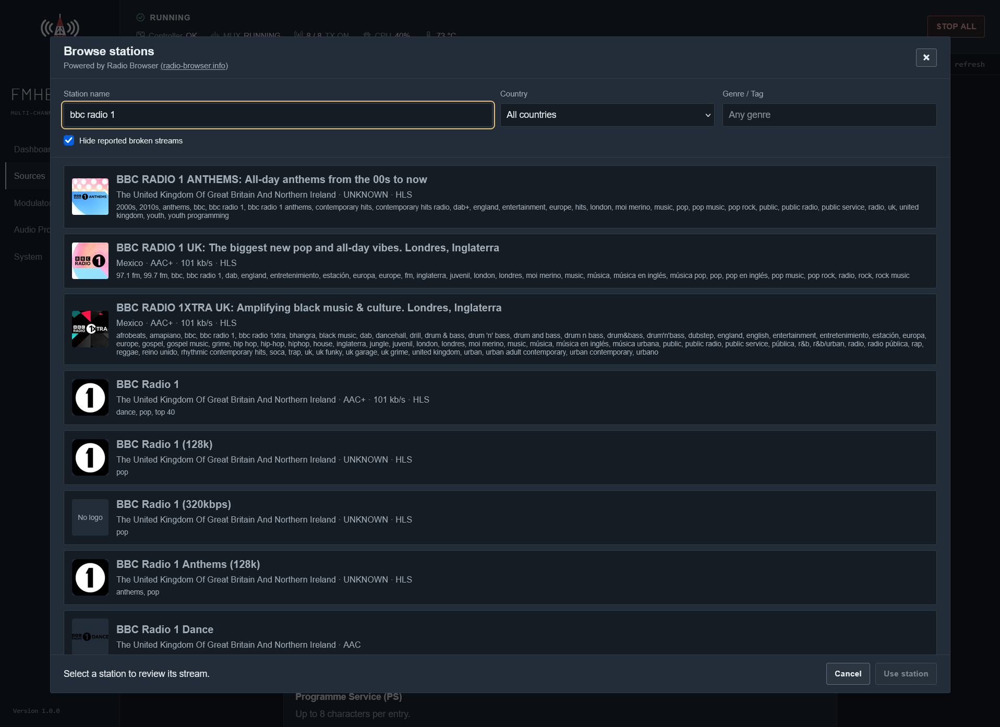
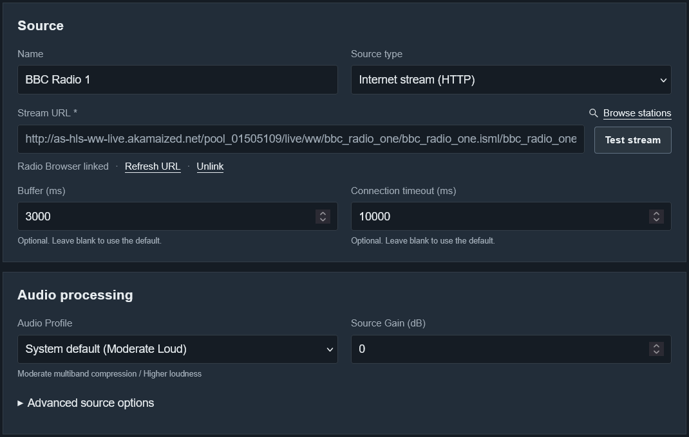
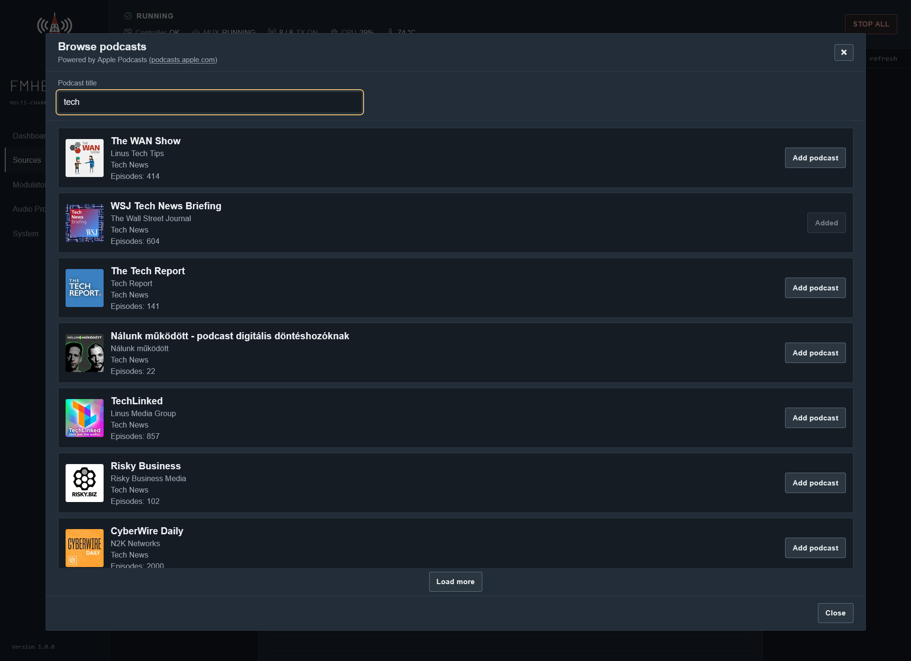
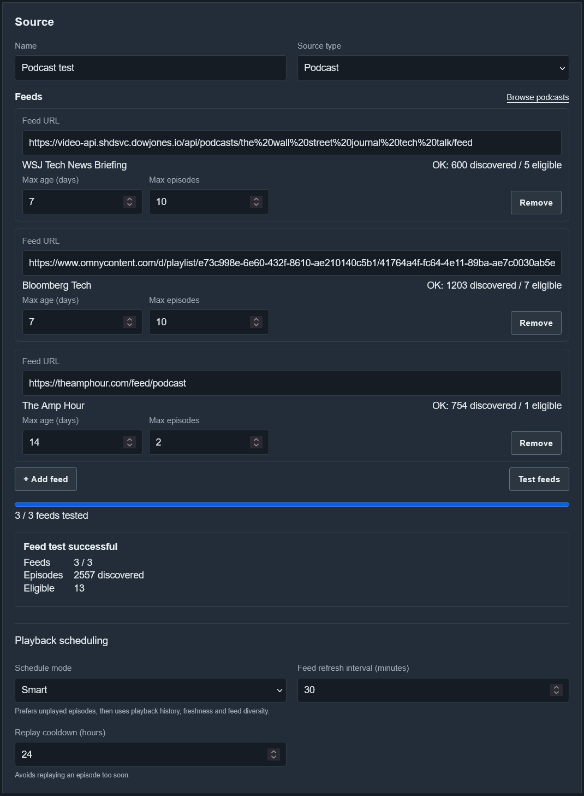
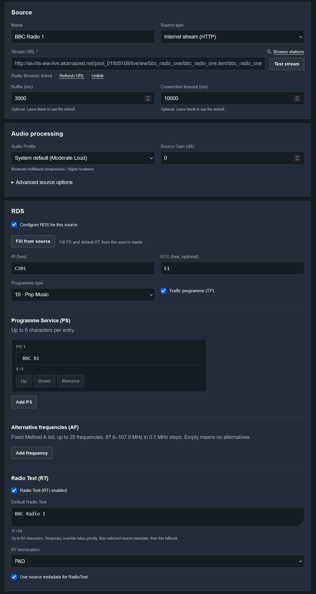
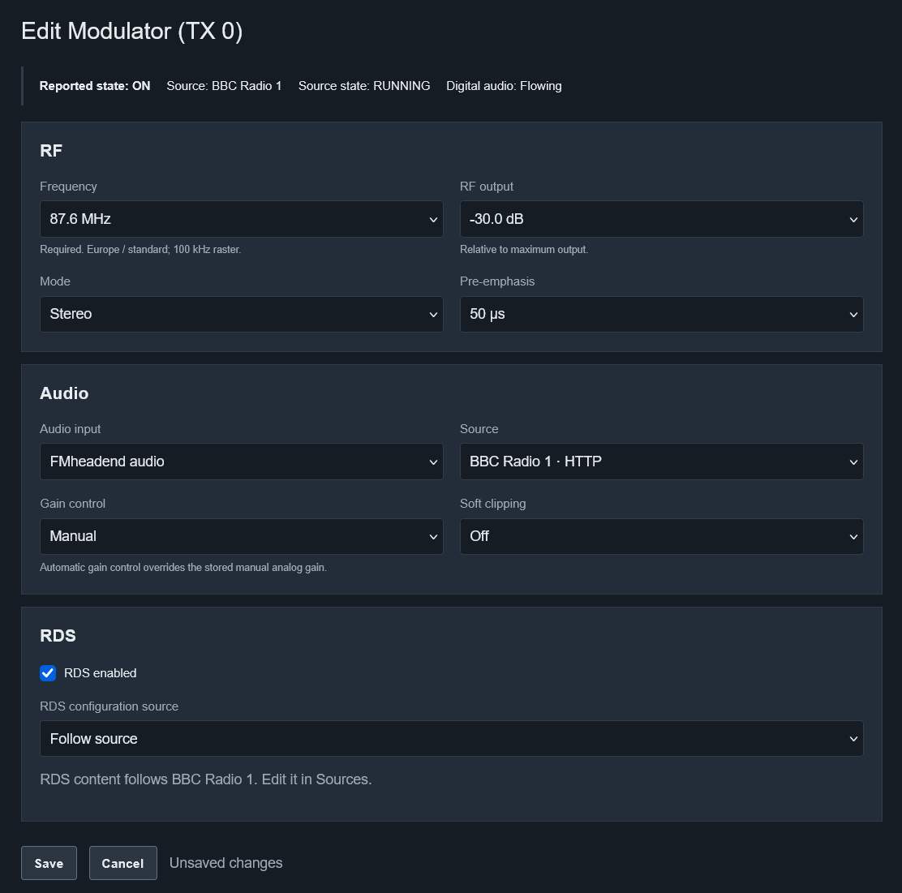

# FMheadend Quick Start Guide

## 1. Prepare your Raspberry Pi and HAT

1. Get a Raspberry Pi running Raspberry Pi OS Lite (64-bit), with SSH enabled and internet access. Raspberry Pi Imager is an easy way to set this up.
2. With the Pi powered off, mount the FMheadend HAT. Connect its RF output directly to your receiver's FM antenna input using a suitable coaxial cable.
3. Power up the Pi. From a computer on the same network, log in over SSH using the username and hostname you configured.

> [!NOTE]
> Connecting an antenna changes the RF characteristics of the system. Any wireless operation must comply with the applicable local radio regulations, including radiated power and interference limits.

## 2. Install FMheadend

Run this in your SSH session as your regular user:

```bash
curl -fsSL https://raw.githubusercontent.com/csalotzky/fmheadend/master/bootstrap.sh | bash
```

The interactive installer handles the initial FM region, default Audio Profile, WebUI access and Raspberry Pi hardware configuration. Note the WebUI address it prints. Reboot if requested.

## 3. Open the WebUI

Open the WebUI address shown by the installer in a browser on the same network. Sign in if prompted. If everything is working correctly, you should see **Controller OK** in the top status bar.

The **Dashboard** shows all detected transmitters, initially with their frequencies **Unset**. System status and telemetry appear across the top, while the sidebar provides access to the main configuration pages.

<a href="../assets/dashboard-blank.png"></a>

## 4. Audio sources

FMheadend separates audio **Sources** from physical FM **Modulators**. A Source defines what to play, independently of the Modulator that will transmit it. That's why we configure the Source first.

FMheadend supports internet radio, podcasts, local files and playlists, UDP/RTP streams, and sound card inputs. All types are covered in the [Audio Sources guide](sources.md). Here, we'll look at internet radio and podcasts.

Each Source can use the system default **Audio Profile** or its own processing preset. See [Audio processing](audio.md) for details.

RDS can be configured in either the Source Editor or the Modulator Editor. We'll configure it in the Source Editor in the next section.

### Internet radio

1. Open **Sources → Add source** and select **Internet stream (HTTP)**.
2. Click **Browse stations**, find a station and click **Use station**. Its settings will appear in the editor. Alternatively, enter a **Stream URL** manually.

   <a href="../assets/radio-browser.png"></a>

3. Edit the automatically filled **Name** if desired.
4. Click **Test stream** to verify that the station works.

   <a href="../assets/source-edit-http.png"></a>

### Podcast

1. Open **Sources → Add source** and select **Podcast**.
2. A Podcast Source can contain multiple feeds. Enter their URLs manually or click **Browse podcasts** to search the Apple Podcasts directory and add your favorites.

   <a href="../assets/podcast-browser.png"></a>

3. Set **Max age (days)** and **Max episodes** for each feed. For example, `7` and `10` limits the selection to the 10 newest episodes published within the last 7 days.
4. Choose a **Schedule mode**:
   - **Random:** Shuffles eligible episodes without playback-history priorities.
   - **Smart:** Tracks playback history, prioritizing unplayed and newer episodes.

   **Replay cooldown (hours)** tells Smart how long to avoid repeating an episode. If no alternatives are available, the cooldown can be relaxed.
5. Set **Feed refresh interval (minutes)** to control how often FMheadend checks for new episodes.
6. Click **Test feeds** to check the feeds and see how many episodes are eligible for playback.
7. Give your Source a **Name**.

   <a href="../assets/source-edit-podcast.png"></a>


For either type, leave **Audio Profile** on **System default** and **Source Gain** at **0 dB**.

Don't save yet. We'll configure RDS next.

## 5. Configure RDS for your station

1. In the Source Editor, check **Configure RDS for this source**.
2. Enter your station's four-digit hexadecimal identifier in **PI (hex)**. For this cabled test, you can use `1234`. Choose the **Programme type** (PTY) that fits your programme.
3. In **PS 1**, enter the station name the radio should display, up to eight characters. Try `HOME FM`.
4. Check **Radio Text (RT) enabled**. In **Default Radio Text**, enter a short message, such as `Welcome to Home FM`. Leave **Use source metadata for RadioText** unchecked so you can recognize your message on the receiver. Click **Save**.

<a href="../assets/source-edit.png"></a>

## 6. Configure your first transmitter

The Source supplies the programme audio. The Modulator sets where and how you transmit it.

1. Open **Modulators → Edit TX 0**. Under **Frequency**, choose the quiet frequency you noted earlier. As a precaution, leave at least 400 kHz (0.4 MHz) from any station you can receive, where practical.
2. Start with **RF output** at **-40.5 dB**, the lowest setting, for the direct cable connection.
3. Set **Audio input** to **FMheadend audio**. In **Source**, select the name you saved.
4. Check **RDS enabled**. Set **RDS configuration source** to **Follow source**, then click **Save**.

<a href="../assets/tx-edit.png"></a>

## 7. Start broadcasting!

On the **Dashboard**, click **START** on **TX 0**. Wait for **Reported state: ON**. Tune your receiver to the frequency you selected and listen for the stream. On an RDS radio, look for your station name and open its RadioText display to read your message. Your first station is on air!
