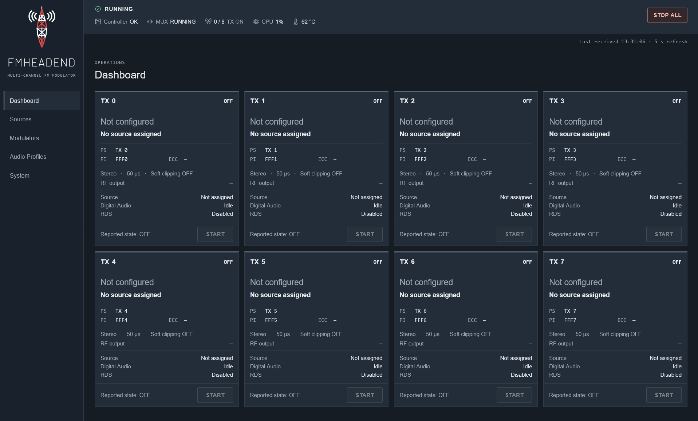

# FMheadend Quick Start Guide

## 1. Prepare your Raspberry Pi and HAT

1. Get a Raspberry Pi running Raspberry Pi OS Lite (64-bit), with SSH enabled and internet access. Raspberry Pi Imager is an easy way to set this up.
2. With the Pi powered off, mount the FMheadend HAT. Connect its RF output directly to your receiver's FM antenna input using a suitable coaxial cable.
3. Power up the Pi. From a computer on the same network, log in over SSH using the username and hostname you configured.

> [!NOTE]
> Connecting an antenna changes the RF characteristics of the system. Any wireless operation must comply with the applicable local radio regulations, including radiated power and interference limits.

## 2. Install FMheadend

Run this in your SSH session as your regular user:

```bash
curl -fsSL https://raw.githubusercontent.com/csalotzky/fmheadend/master/bootstrap.sh | bash
```

The interactive installer handles the initial FM region, default Audio Profile, WebUI access and Raspberry Pi hardware configuration. Note the WebUI address it prints. Reboot if requested.

## 3. Open the WebUI

Open the WebUI address shown by the installer in a browser on the same network. Sign in if prompted. If everything is working correctly, you should see **Controller OK** in the top status bar.

The **Dashboard** shows all detected transmitters, initially with their frequencies **Unset**. System status and telemetry appear across the top, while the sidebar provides access to the main configuration pages.

<a href="../assets/dashboard-blank.png"></a>

## 4. Create your first audio source

1. Open **Sources → Add source**. Set **Source type** to **Internet stream (HTTP)**.
2. Click **Browse stations**. In **Station name**, search for a station you know. Select a result, then click **Use station**. This fills **Stream URL** and, if blank, **Name**. Use a name you'll recognize later.
3. Click **Test stream** and look for **Test successful**. If it fails, try another station.
4. Leave **Audio Profile** on **System default** to use the audio processing you chose during installation. **Source Gain (dB)** adjusts this source's level. Start at **0 dB**. Keep the editor open for RDS.

<a href="../assets/radio-browser.png"></a>

For your own music, **Local media** plays a folder or playlist. **Podcast** plays episodes from RSS feeds. See [Local media](sources.md#14-local-media) or [Podcasts](sources.md#15-podcasts).

## 5. Configure RDS for your station

1. In the Source Editor, check **Configure RDS for this source**.
2. Enter your station's four-digit hexadecimal identifier in **PI (hex)**. For this cabled test, you can use `1234`. Choose the **Programme type** (PTY) that fits your programme.
3. In **PS 1**, enter the station name the radio should display, up to eight characters. Try `HOME FM`.
4. Check **Radio Text (RT) enabled**. In **Default Radio Text**, enter a short message, such as `Welcome to Home FM`. Leave **Use source metadata for RadioText** unchecked so you can recognize your message on the receiver. Click **Save**.

<a href="../assets/source-edit.png"></a>

## 6. Configure your first transmitter

The Source supplies the programme audio. The Modulator sets where and how you transmit it.

1. Open **Modulators → Edit TX 0**. Under **Frequency**, choose the quiet frequency you noted earlier. As a precaution, leave at least 400 kHz (0.4 MHz) from any station you can receive, where practical.
2. Start with **RF output** at **-40.5 dB**, the lowest setting, for the direct cable connection.
3. Set **Audio input** to **FMheadend audio**. In **Source**, select the name you saved.
4. Check **RDS enabled**. Set **RDS configuration source** to **Follow source**, then click **Save**.

<a href="../assets/tx-edit.png"></a>

## 7. Start broadcasting!

On the **Dashboard**, click **START** on **TX 0**. Wait for **Reported state: ON**. Tune your receiver to the frequency you selected and listen for the stream. On an RDS radio, look for your station name and open its RadioText display to read your message. Your first station is on air!
