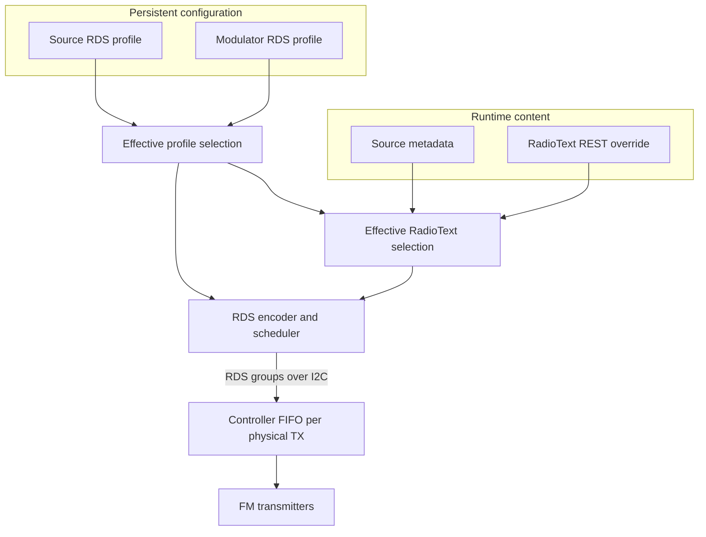

# RDS in FMheadend

## 1. RDS overview

FMheadend generates RDS on the Raspberry Pi and sends complete RDS groups to the Controller.
Configuration may belong to a Source or to one Modulator. Runtime Source metadata and an external
RadioText override can replace the configured default text without changing saved configuration.



The backend emits the following group types:

| Group | Content |
|---|---|
| 0A | PI, PTY, TP, PS, stereo decoder information and AF |
| 1A | ECC, when configured |
| 2A | RadioText, when enabled |

FMheadend does not expose raw RDS-group injection through its REST API. Low-level Controller framing
is documented in [Controller protocol](controller-protocol.md).

## 2. RDS configuration and ownership

Each Source can own one RDS profile. Each Modulator also retains its own override profile and chooses
either **Follow source** or its Modulator-specific profile.

| Selection | Effective configuration |
|---|---|
| Follow source | The profile owned by the assigned digital Source |
| Modulator profile | The profile stored for that Modulator |

Following a Source requires a digital Source with an RDS profile. Changing the assigned Source changes
the effective profile accordingly. A Modulator profile remains stored while the Modulator follows its
Source, so switching back restores it. Multiple Modulators may follow the same Source profile while
retaining independent runtime RadioText overrides.

Edit a Source-owned profile in **Sources**. In a Modulator's **RDS** section, enable RDS and set
**RDS configuration source** to **Follow source** or **Custom**; Custom exposes that Modulator's editor.

| Control | Purpose and limits |
|---|---|
| PI | 16-bit Programme Identification code |
| PS | One or more entries of 1–8 characters |
| PS duration | Positive display duration for each entry |
| PTY | Numeric programme type, 0–31 |
| TP | Traffic programme identification flag |
| ECC | Optional 8-bit Extended Country Code |
| AF | Up to 25 frequencies from 87.6 to 107.9 MHz in 100 kHz steps |
| Default RadioText | Up to 64 printable characters |
| RadioText enabled | Enables or suppresses 2A groups |
| RT termination | `PAD` fills 64 bytes; `CR` reserves one byte for a terminator |
| Source metadata | Allows the current Source title to replace default RadioText |

The US region displays RBDS PTY names in the editor. Expert, Europe and Japan display European RDS
names. Codes 30 and 31 remain valid persisted values but are deliberately absent from the selector.
Region selection changes labels, not the stored numeric PTY code or transmitted encoding.

Saving PI, PS, PTY, TP, ECC, AF or RadioText content while a TX is running applies the new RDS profile
without rebuilding its audio pipeline. FMheadend resets the affected RDS queue and starts filling it
with groups from the new profile. Enabling or disabling RDS changes transmitter configuration and can
therefore use the normal stop, configure and resume path.

## 3. Dynamic RadioText

Effective RadioText is selected independently for each Modulator in this order:

| Priority | Source | `origin` returned by the API |
|---:|---|---|
| 1 | Unexpired external override for the Modulator | `override` |
| 2 | Non-empty title from its assigned Source, when metadata-to-RT is enabled | `metadata` |
| 3 | Default RadioText in the effective profile | `fallback` |

An override belongs to one Modulator, even when several Modulators share the same Source. It is held
in memory, is not written to the database and does not survive a backend restart. It remains associated
with that Modulator across Source or profile changes until it expires, is cleared, or the backend exits.

An empty string is a valid explicit override. It suppresses metadata and fallback text until cleared or
expired. Source metadata is truncated to the 64-character RadioText limit. PS and RadioText use the
standard **RDS/EBU character set defined by IEC 62106-4:2018**. Input is converted from Unicode;
characters outside that set are transliterated where possible and otherwise replaced with `?`.

The effective value can be read while RDS or RadioText transmission is disabled, but it is not emitted
until RDS and RadioText are enabled for that Modulator. Expiry returns selection to metadata or fallback
automatically. The scheduler notices the content change, toggles the RadioText A/B flag and rebuilds the
affected queued RadioText groups.

## 4. RDS scheduling and delivery

PS entries form a carousel. Each entry remains selected for its configured duration, then the scheduler
moves to the next entry and starts again after the last. A single entry repeats continuously. A profile
change resets the affected PS sequence.

The scheduler uses smooth weighted allocation rather than sending one entire message type at a time:

| Content | Allocation policy |
|---|---|
| PS | At least 60% of scheduled groups |
| RadioText | At least 30% when enabled; receives unused capacity after ECC |
| ECC | 2% when configured |
| Unused shares | Assigned to RadioText when enabled, otherwise to PS |

These shares govern host-side group selection; they do not guarantee a receiver display interval.
Receiver decoding, FIFO backlog and reception conditions also affect when changed content becomes visible.

For each active physical transmitter, the backend reads available Controller FIFO capacity and sends only
complete groups that fit. A batch advances scheduler state only after the Controller acknowledges it. A
busy FIFO is retried without changing the pending batch. Ambiguous transport outcomes cause the backend
to clear and re-establish the affected queue before continuing, avoiding uncertain duplicate delivery.

The three relevant milestones are distinct:

1. **Selected:** the backend has chosen the effective profile and RadioText.
2. **Accepted:** encoded groups have been acknowledged into the Controller FIFO.
3. **On air:** the Controller and transmitter have consumed and transmitted those groups.

An HTTP success or an accepted-group counter proves neither receiver-visible content nor RF transmission.
RDS feeding requires an enabled, Controller-observed ON transmitter and working Controller communication.
Stopping a TX, disabling RDS or losing the Controller clears or suspends the target queue. After recovery,
FMheadend re-establishes queue state and resumes filling only when the target is ready. A fault on one
target is kept local where communication permits; a shared Controller communication failure can suspend
all refill work.

## 5. External RadioText control

Automation systems control the runtime override for one Modulator through three endpoints. Replace `3`
with the Modulator ID. If HTTP authentication is enabled, supply the configured Basic credentials over
HTTPS or another trusted encrypted transport.

Set an override with a five-minute expiry:

```bash
curl -u '<user>:<password>' -X PUT http://localhost:8080/api/v1/modulators/3/rds/rt \
  -H 'Content-Type: application/json' \
  -d '{"text":"Live programme","ttl_s":300}'
```

`text` accepts at most 64 printable characters, including an empty string. `ttl_s`, when present, must be
a finite number greater than zero; it has no configured maximum. Omit it or send `null` for an override
without automatic expiry.

Read the currently selected text and its source:

```bash
curl -u '<user>:<password>' http://localhost:8080/api/v1/modulators/3/rds/rt
```

```json
{"text":"Live programme","origin":"override","remaining_ttl_s":287.4}
```

Without an override, `GET` returns the selected metadata or fallback text. `remaining_ttl_s` is non-null
only for an expiring override. Clear the override and return immediately to normal selection:

```bash
curl -u '<user>:<password>' -X DELETE http://localhost:8080/api/v1/modulators/3/rds/rt
```

`DELETE` returns HTTP 204. Invalid text or TTL values return HTTP 422; an unavailable physical Modulator
returns HTTP 404. Until Controller capability and availability negotiation completes, requests return
HTTP 503. The complete endpoint inventory is in the [REST API reference](api.md).

## 6. Status and troubleshooting

| Symptom | What to check |
|---|---|
| No PS or RadioText | Confirm RDS is enabled, the TX is observed ON and Controller communication is healthy. |
| PS appears but RadioText does not | Confirm **RadioText enabled** in the effective profile. |
| Metadata does not replace default text | Enable source metadata for RadioText and check that the Source reports a non-empty title. |
| Override disappeared | Read `origin` and `remaining_ttl_s`; it may have expired or the backend may have restarted. |
| Updated status but old receiver text | Selected content can precede FIFO consumption and receiver decoding; inspect FIFO and Controller status. |
| RDS state is `BUSY`, `ERROR` or `UNKNOWN` | Inspect the TX card error, Controller connectivity and RDS fields in `/api/v1/status`. |
| Saved profile differs from transmitted content | Check Source-following, runtime override origin and status freshness before comparing values. |

The status snapshot exposes selected effective RadioText, the RadioText A/B state, FIFO free space,
accepted-group counters and the latest RDS error where available. The runtime RadioText `GET` endpoint
reports the text's origin and any remaining TTL. These are backend and Controller observations, not
direct measurements of receiver output. See [Operations](operations.md) for general status interpretation
and [WebUI](webui.md) for the editor workflow.
